# Test evidence

> 规则：**只写真实命令与原始输出**。每个阶段一节；没跑的项写 `NOT RUN` 并说明原因，
> 不允许把"应该能过"写成"通过"。P0 章节的每一条都能在 `docs/P0-AUDIT.md` 里找到对应结论。

## 如何复现（P0，2026-11-18）

| 项 | 值 |
|---|---|
| 主机 | Windows 11 10.0.26200 amd64（中国大陆网络） |
| JDK | 25.0.3 LTS（`JAVA_HOME=F:\Coding\Java\jdk-25.0.3`） |
| Gradle | 9.6.0（wrapper 固定，`gradle/wrapper/gradle-wrapper.properties`） |
| AGP / ktlint | 9.5.1 / 14.2.0（`gradle/libs.versions.toml`） |
| Android SDK | platform 36、build-tools 36.1.0（`local.properties` 指向 `%LOCALAPPDATA%\Android\Sdk`） |
| Go | go1.27.4 windows/amd64（`F:\Coding\Go\go`） |
| Go 模块代理 | `GOPROXY=https://goproxy.cn,direct`（`proxy.golang.org` 在本网络不可达） |

基线只读：所有 Go 命令都在 `F:\Temp\baseline-verify`（`baseline/proton-sidecar` 的副本）里跑。

---

## 网络路径自检（所有网络证据的前提）

这台开发机**同时**跑着 FlClash（系统代理 + 自家的 proton-stealth 节点）、ProtonVPN 客户端与 Tailscale，
所以任何"真实网络"结论都必须先证明它没有走宿主代理。本次审计（2026-11-19）的结论：

| 事实 | 证据 |
|---|---|
| 没有 TUN 抢默认路由 | 唯一默认路由是 WLAN/10.241.0.1（`Get-NetRoute`） |
| FlClash 是 **system-proxy** 模式 | `HKCU\...\Internet Settings`：`ProxyEnable=1`、`ProxyServer=127.0.0.1:7890` |
| 宿主代理链的出口是 Proton | `curl -x http://127.0.0.1:7890` 与 `-x socks5h://127.0.0.1:1080` 都得到 `169.150.231.172` |
| 我们的直连**没有**经过它 | `netcheck` 显示源地址是 `10.241.99.222`（WLAN 网卡），扫描进程的 TCP 连接全部直连入口 IP，没有一条连到 `127.0.0.1:7890` |
| Go 不会用系统代理 | 我们的 transport 显式 `Proxy=nil`，扫描是裸 `net.Dialer`；WinINET 设置对 Go 不可见 |

原始输出：

```
# 宿主网络路径自检（2026-11-19）

## 这台 Windows 上同时运行的东西

ProcessName               Id
-----------               --
FlClash                28512
FlClashCore            29232
FlClashHelperService    7300
proton-stealth         32044
ProtonVPN.NrptWatchdog 12972
ProtonVPNService        7396
tailscaled              7896
tailscaled             13092
tailscale-ipn          31264
## 默认路由（有没有 TUN 抢默认路由）
ifIndex InterfaceAlias NextHop    RouteMetric ifMetric
------- -------------- -------    ----------- --------
     11 WLAN           10.241.0.1           0
## 系统代理（WinINET，FlClash 的 system-proxy 模式）
ProxyEnable : 1
ProxyServer : 127.0.0.1:7890
## FlClash 的出口 IP（经过它自己的代理链）
via http://127.0.0.1:7890      -> 169.150.231.172
via socks5h://127.0.0.1:1080   -> 169.150.231.172

## 我们自己的直连证据：netcheck（本地源地址 + 网卡）
env proxies: HTTP_PROXY=  HTTPS_PROXY=  (the node ignores them: transport Proxy=nil and raw dials are used)
212.102.51.121:443       direct ok in 320ms, local 10.241.99.222:64752 on WLAN
212.102.51.122:443       direct ok in 319ms, local 10.241.99.222:64754 on WLAN
185.70.42.25:443         direct ok in 244ms, local 10.241.99.222:64757 on WLAN
8.8.8.8:443              FAILED after 5.001s: dial tcp 8.8.8.8:443: i/o timeout

## 扫描进程的 TCP 连接（无 127.0.0.1:7890）
RemoteAddress  RemotePort       State
-------------  ----------       -----
103.125.235.20        443     SynSent
138.199.21.213        443     SynSent
138.199.21.214        443     SynSent
185.159.156.37        443     SynSent
185.159.156.56        443     SynSent
185.70.42.25          443 Established
45.14.71.5            443     SynSent
45.14.71.6            443     SynSent
45.87.213.210         443     SynSent
62.169.136.208        443     SynSent
62.169.136.80         443     SynSent
79.135.104.40         443     SynSent
```

**规则（写进 CONTRIBUTING）**：任何一次要写进本文件"真实网络"结论的运行，先跑

```bash
protonnode-cli netcheck -target <entry-ip>:443,<entry-ip>:443
```

源地址必须是物理网卡的 IP（Windows 的 WLAN、手机会是 wlan0），不能是 `127.0.0.1`、Tailscale（100.x）或 TUN。

**对已记录证据的影响**：

- **Windows 侧（P1/P2/P3 的 Windows 证据）**：直连，未受 FlClash 影响（上面的证据成立）。
- **平板（OPD2514）侧的 P1/P2 证据**：初次采集时 `vgate0` 处于 up（设备上其实没有装 FlClash，只有 ProtonVPN），
  路径未被证明。**2026-11-19 22:04 已在无 VPN 状态下重做**：`netcheck` 源地址 `10.241.100.148`/`wlan0`，
  `selftest` 12.52s connected（US-CO#103，握手 828ms），`udptest` UDP DNS 31→79 字节 —— 见 P4-E3b。
- **16 KB 模拟器（A12）**：模拟器里没有 FlClash，路径干净。

> 这也是 P6 要验证的东西：FlClash 开启 TUN 时，本应用必须被 `PROCESS-NAME,<包名>,DIRECT` 排除，
> 否则我们的 API/隧道连接会被自己的 VPN 再抓一遍（死循环或测到假路径）。

## P0 — 审计 + 骨架

### P0-E1 工具链

```

------------------------------------------------------------
Gradle 9.6.0
------------------------------------------------------------

Build time:    2026-06-18 23:19:03 UTC
Revision:      3f750f03d77e42327c5f9fcb9992110088330a32

Kotlin:        2.3.21
Groovy:        4.0.32
Ant:           Apache Ant(TM) version 1.10.17 compiled on April 6 2026
Launcher JVM:  25.0.3 (Oracle Corporation 25.0.3+9-LTS-195)
Daemon JVM:    F:\Coding\Java\jdk-25.0.3 (no Daemon JVM specified, using current Java home)
OS:            Windows 11 10.0 amd64


[exit 0]
```

```
java version "25.0.3" 2026-04-21 LTS
Java(TM) SE Runtime Environment (build 25.0.3+9-LTS-195)
Java HotSpot(TM) 64-Bit Server VM (build 25.0.3+9-LTS-195, mixed mode, sharing)

[exit 0]
```

```
go version go1.27.4 windows/amd64

[exit 0]
```

### P0-E2 仓库状态（P0 提交之前）

```
a1d9fef

[exit 0]
```

```
a1d9fef (HEAD -> main) chore: bootstrap repo (gitignore, hooks, CI, security, docs)

[exit 0]
```

```
 M .gitattributes
 M .github/workflows/ci.yml
 M .github/workflows/security.yml
 M .gitignore
 M CHANGELOG.md
 M CONTRIBUTING.md
 M README.md
 M scripts/check-16kb.sh
?? CODE_OF_CONDUCT.md
?? app/
?? build.gradle.kts
?? core/
?? docs/P0-AUDIT.md
?? gradle.properties
?? gradle/
?? gradlew
?? gradlew.bat
?? settings.gradle.kts

[exit 0]
```

### P0-E3 基线：Windows 构建 / vet / 测试

```powershell
cd F:\Temp\baseline-verify
go build ./...
go vet ./...
go test ./... -count=1 -v
```

```
（无输出，exit 0）
```

```
（无输出，exit 0）
```

```
?   	github.com/dsh/proton-stealth-sidecar/cmd/proton-stealth	[no test files]
?   	github.com/dsh/proton-stealth-sidecar/internal/proton	[no test files]
?   	github.com/dsh/proton-stealth-sidecar/internal/socks5	[no test files]
?   	github.com/dsh/proton-stealth-sidecar/internal/state	[no test files]
=== RUN   TestFrameRoundTrip
--- PASS: TestFrameRoundTrip (0.00s)
=== RUN   TestHandshakeFrameIsNormal
--- PASS: TestHandshakeFrameIsNormal (0.00s)
=== RUN   TestDecodeRejectsGarbage
--- PASS: TestDecodeRejectsGarbage (0.00s)
PASS
ok  	github.com/dsh/proton-stealth-sidecar/internal/stealth	0.032s
=== RUN   TestStealthTunnelEndToEnd
    integration_test.go:132: handshake ok in 250ms (SNI fonts.gstatic.com)
ERROR: wg: 2026/11/18 17:56:21 peer(sKYw…CTFE) - Failed to send data packets: use of closed network connection
--- PASS: TestStealthTunnelEndToEnd (0.69s)
PASS
ok  	github.com/dsh/proton-stealth-sidecar/internal/tunnel	0.745s

[exit 0]
```

> 结论：4 个测试全过；端到端测试 `TestStealthTunnelEndToEnd` 用同一条 TLS+TunSafe 流建立 WireGuard
> 握手，再经 gVisor netstack + SOCKS5 取回 6000 字节 HTTP 响应，逐字节一致（0.69s）。
> 日志里 `Bind close failed: ... closeNotify ...` 是测试结束后关闭连接时的噪声，不影响 PASS。

### P0-E4 基线：android/arm64 交叉构建与依赖事实

```powershell
$env:GOOS="android"; $env:GOARCH="arm64"; $env:CGO_ENABLED="0"
go build ./...
go vet ./...
go list -deps -f "{{.ImportPath}}" ./...      # 依赖闭包
go list -deps -f "{{if .CgoFiles}}{{.ImportPath}}{{end}}" ./...   # cgo 包
go build -o F:\Temp\cli-android-arm64 ./cmd/proton-stealth
```

```
（无输出，exit 0）
```

```
（无输出，exit 0）
```

```
unique packages: 347
gvisor packages: 42
utls packages: 12
wireguard packages: 9
wintun packages: 0
cgo packages: 0
```

```
（无输出，exit 0）
```

```
android/arm64 binary: 18300878 bytes
```

> 结论：整个基线（含 CLI）在 android/arm64、`CGO_ENABLED=0` 下可编译可 vet；依赖闭包 347 个包，
> 其中 0 个含 cgo 文件、0 个引用 wintun。18.3 MB 是单文件 CLI 的体积（含 gVisor netstack 42 个包）。

### P0-E5 Go core 模块门（`cd core && go test ./...`）

```bash
cd core
go vet ./...
go test ./... -count=1 -v
```

```
（无输出，exit 0）
```

```
?   	github.com/Leggerezza/android-proton/core/protonnode	[no test files]

[exit 0]
```

> P0 的 core 只有 `protonnode/doc.go`（模块与包文档），**没有任何假实现**，所以 `go test` 报 `[no test files]`。
> 这是 P0 的预期结果：真正的测试在 P1 随协议代码一起进来。

### P0-E6 Android 构建门（`./gradlew assembleDebug`）

```bash
./gradlew clean assembleDebug --no-build-cache --no-configuration-cache --console=plain
```

```
Starting a Gradle Daemon, 1 busy and 2 incompatible and 10 stopped Daemons could not be reused, use --status for details
> Task :app:clean
> Task :app:preBuild UP-TO-DATE
> Task :app:preDebugBuild UP-TO-DATE
> Task :app:mergeDebugNativeDebugMetadata NO-SOURCE
> Task :app:generateDebugResources
> Task :app:packageDebugResources
> Task :app:processDebugNavigationResources
[... 29 lines omitted ...]
> Task :app:compressDebugJavaRes
> Task :app:mergeDebugJavaResource
> Task :app:dexBuilderDebug
> Task :app:mergeProjectDexDebug
> Task :app:packageDebug
> Task :app:createDebugApkListingFileRedirect
> Task :app:assembleDebug

BUILD SUCCESSFUL in 13s
35 actionable tasks: 35 executed

[exit 0]
```

APK 信息（`aapt2 dump badging` + sha256）：

```
package: name='io.github.leggerezza.protonnode.debug' versionCode='1' versionName='0.1.0' platformBuildVersionName='16' platformBuildVersionCode='36' compileSdkVersion='36' compileSdkVersionCodename='16'
minSdkVersion:'26'
targetSdkVersion:'36'
uses-permission: name='android.permission.INTERNET'
uses-permission: name='android.permission.ACCESS_NETWORK_STATE'
application-label:'Proton Node'
application: label='Proton Node' icon=''
application-debuggable
feature-group: label=''
  uses-feature: name='android.hardware.faketouch'
  uses-implied-feature: name='android.hardware.faketouch' reason='default feature for all apps'
supports-screens: 'small' 'normal' 'large' 'xlarge'
supports-any-density: 'true'
locales: '--_--'
densities: '160'

[exit 0]
```

```
02b5f4d8b880d3a8863d155556ede459fda13e77e36b74379fe8018807637071  app/build/outputs/apk/debug/app-debug.apk
871846 bytes
```

> 两次独立构建（一次用 build cache、一次 `--no-build-cache`）产出的 APK sha256 完全相同，
> 说明在当前 Gradle/AGP 下构建是确定性的。

### P0-E7 质量门：ktlint / 单元测试 / Android Lint

```bash
./gradlew :app:ktlintCheck :app:testDebugUnitTest :app:lintDebug --console=plain
```

```
[... 68 lines omitted ...]

> Task :app:lintReportDebug
Wrote HTML report to file:///F:/User/Documents/DeepSeek_Harness/handoff-proton-android/android-proton/app/build/reports/lint-results-debug.html
Wrote SARIF report to file:///F:/User/Documents/DeepSeek_Harness/handoff-proton-android/android-proton/app/build/reports/lint-results-debug.sarif

> Task :app:lintDebug

BUILD SUCCESSFUL in 6s
36 actionable tasks: 8 executed, 9 from cache, 19 up-to-date
Configuration cache entry reused.

[exit 0]
```

Lint 报告（`app/build/reports/lint-results-debug.txt`）：

```
F:\User\Documents\DeepSeek_Harness\handoff-proton-android\android-proton\app\build.gradle.kts:35: Warning: Not targeting the latest versions of Android; compatibility modes apply. Consider testing and updating this version. Consult the android.os.Build.VERSION_CODES javadoc for details. [OldTargetApi]
F:\User\Documents\DeepSeek_Harness\handoff-proton-android\android-proton\gradle\wrapper\gradle-wrapper.properties:3: Warning: A newer version of Gradle than 9.6.0 is available: 9.9.1 [AndroidGradlePluginVersion]
F:\User\Documents\DeepSeek_Harness\handoff-proton-android\android-proton\app\build.gradle.kts:30: Warning: A newer version of compileSdk than 36 is available: 37 [GradleDependency]
F:\User\Documents\DeepSeek_Harness\handoff-proton-android\android-proton\app\build.gradle.kts:41: Warning: Missing x86_64 ABI support for ChromeOS [ChromeOsAbiSupport]
F:\User\Documents\DeepSeek_Harness\handoff-proton-android\android-proton\app\src\main\AndroidManifest.xml:12: Warning: The attribute android:allowBackup is deprecated from Android 12 and higher and may be removed in future versions. Consider adding the attribute android:dataExtractionRules specifying an @xml resource which configures cloud backups and device transfers on Android 12 and higher. [DataExtractionRules]
F:\User\Documents\DeepSeek_Harness\handoff-proton-android\android-proton\app\src\main\AndroidManifest.xml:10: Warning: Should explicitly set android:icon, there is no default [MissingApplicationIcon]
0 errors, 6 warnings
```

> 0 error、6 warning。6 条都是提示级：targetSdk 36 未跟到 37（PROMPT 要求 API 36）、
> compileSdk 37 可用、Gradle 9.9.1 可用、ChromeOS x86_64 未打包（§6.1 只要 arm64）、
> `allowBackup` 建议配 `dataExtractionRules`、缺应用图标（P5 做 UI 时补）。
> `:app:testDebugUnitTest` 在 P0 是 `NO-SOURCE`（app 模块尚无测试源码）。

### P0-E8 16 KB 对齐门

```bash
bash scripts/check-16kb.sh app/build/outputs/apk/release/app-release-unsigned.apk
bash scripts/check-16kb.sh          # 不带参数时自动挑最新的 release APK
```

```
checking app/build/outputs/apk/release/app-release-unsigned.apk
no .so in APK (pure-Java build?) - skipping alignment check
zipalign 16KB: OK
16 KB check passed

[exit 0]
```

```
checking app/build/outputs/apk/release/app-release-unsigned.apk
no .so in APK (pure-Java build?) - skipping alignment check
zipalign 16KB: OK
16 KB check passed

[exit 0]
```

`zipalign -c -P 16 -v 4`（debug APK，全量输出见构建日志摘要）：

```
[... 13 lines omitted ...]
  858310 kotlin/kotlin.kotlin_builtins (OK - compressed)
  863718 kotlin/ranges/ranges.kotlin_builtins (OK - compressed)
  865140 kotlin/reflect/reflect.kotlin_builtins (OK - compressed)
Verification successful

[exit 0]
```

> P0 的 APK 里还没有 `.so`（gomobile 的 AAR 在 P1 才接进来），所以脚本走的是 "no .so ... skipping" 分支，
> 只验证了 APK 容器本身的 16 KB 对齐。**`.so` 的 LOAD 段对齐（A2）仍未验证**，见 `docs/P0-AUDIT.md` §7。

### P0-E9 PROMPT §9.2 必备文件清单

| 文件 | 状态 | 字节 |
|---|---|---|
| `README.md` | present | 2251 |
| `LICENSE` | present | 627 |
| `NOTICE` | present | 512 |
| `SECURITY.md` | present | 991 |
| `CONTRIBUTING.md` | present | 1138 |
| `CODE_OF_CONDUCT.md` | present | 2406 |
| `CHANGELOG.md` | present | 768 |
| `.gitignore` | present | 540 |
| `.gitattributes` | present | 174 |
| `.editorconfig` | present | 270 |
| `.github/workflows/ci.yml` | present | 1079 |
| `.github/workflows/security.yml` | present | 1034 |
| `.github/workflows/release.yml` | present | 1062 |
| `docs/ARCHITECTURE.md` | present | 1160 |
| `docs/PROTOCOL.md` | present | 1565 |
| `docs/P0-AUDIT.md` | present | 23804 |
| `docs/TEST-EVIDENCE.md` | **MISSING** | - |

> 首个提交（`a1d9fef`）缺 `CODE_OF_CONDUCT.md`、`docs/P0-AUDIT.md`、`docs/TEST-EVIDENCE.md`，本次 P0 全部补齐。

### P0-E10 全新克隆构建（证明提交树自洽）

CI 的第一步是 `actions/checkout`，所以“提交树能不能独立构建”必须单独证明：克隆到空目录、
没有 `local.properties`（CI 用 `ANDROID_HOME`）、直接构建。

```bash
git clone --branch feat/p0-skeleton . F:\Temp\clone-test
cd F:\Temp\clone-test
git ls-files -s gradlew          # 可执行位必须进 git
./gradlew assembleDebug
cd core && go test ./... -count=1
```

```
F:\Temp> git clone --branch feat/p0-skeleton <repo> F:\Temp\clone-test
F:\Temp\clone-test> git ls-files -s gradlew
100755 249efbb032ce46a80c687c0723eb172e85f6a136 0	gradlew
F:\Temp\clone-test> .\gradlew.bat assembleDebug --console=plain   (ANDROID_HOME set, no local.properties)
> Task :app:packageDebug
> Task :app:assembleDebug
BUILD SUCCESSFUL in 9s
35 actionable tasks: 35 executed

apk: app/build/outputs/apk/debug/app-debug.apk = 871846 bytes
F:\Temp\clone-test\core> go test ./... -count=1
?   github.com/Leggerezza/android-proton/core/protonnode  [no test files]
[exit 0]
```

> 克隆后没有任何配置就能 `assembleDebug`，产出的 APK 与工作区构建的字节数一致（871,846）；
> `gradlew` 的 `100755` 位已连同内容一起提交。
### P0-E11 未执行项（NOT RUN）

| 项 | 原因 | 谁来消除 |
|---|---|---|
| GitHub Actions CI 全流程 | 本地仓库没有远端；CI 的每一步都在本机等价跑过 | 首次 push 后 |
| 真机（OnePlus Pad 4 / OxygenOS 16）安装与运行 | P0 不含隧道与 UI，无可运行功能 | P1 |
| `gomobile bind` 生成 AAR | P1 的产物 | P1（A1） |
| `.so` 的 16 KB LOAD 段对齐（`readelf`） | 同上 | P1/P7（A2） |
| netstack UDP（SOCKS5 UDP ASSOCIATE） | 基线没有 UDP 代码 | P2（A6） |
| Proton 真实账号登录/握手 | P0 不改协议，且需要真账号 | P1 |
| govulncheck / gitleaks | P8 验收项 | P8 |

---

## P1 — 真实隧道（2026-11-18）

### P1 判定

| 判定项（PROMPT §11 / START-HERE §4） | 结果 | 证据 |
|---|---|---|
| 真实 WireGuard 握手（不是 TLS 握手成功） | ✅ Windows 250 ms；真机 251 ms | P1-E6 / P1-E7 |
| 隧道内 1 个 TCP 请求成功 | ✅ 两端都拿到 Proton 出口 IP | P1-E6 / P1-E7 |
| 真机（OnePlus Pad 4 / Android 16 / arm64） | ✅ 同一份 Go 代码跑通 | P1-E7 |
| gomobile 能绑定 core（A1 前半） | ✅ AAR + classes.jar，14 个方法 | P1-E3 |
| Go 的 .so 满足 16 KB 对齐（A2 前半） | ✅ 4 个 LOAD 段全部 0x4000 | P1-E4 |
| 装进 APK 后仍满足 16 KB（A2 后半） | ✅ release/debug 两个 APK 都过 | P1-E5 |
| JNI 桥在应用进程里真正加载（A1 后半） | ✅ 真机 instrumentation 1/1 通过 | P1-E8 |
| SOCKS5 UDP（A6） | ❌ 未实现，P2 做 | P1-E9 |

### P1-E1 环境

# device (adb -s 10.241.100.148:41427)
model: OPD2514
manufacturer: OnePlus
android release: 16
sdk: 36
abi: arm64-v8a
build: OPD2514_16.0.8.301(EX01)
PAGE_SIZE: 4096

# host toolchain
go: go version go1.27.4 windows/amd64
ndk: Pkg.Desc = Android NDK | Pkg.Revision = 28.2.13676358 | Pkg.BaseRevision = 28.2.13676358 | Pkg.ReleaseName = r28c
gomobile:  mod golang.org/x/mobile v0.0.0-20261117202452-47699113848a h1:jYIfLfiCY1/N6kWqBdUak4c1kMN0vKnoQypLZqbGqv4= |  dep golang.org/x/mod v0.43.0 h1:MFuq5J6s35W9D3IjkwyWc9vHh0nENOrt5K8Iof4ofmg=

llvm-readelf: LLVM (http://llvm.org/):

### P1-E2 core 的 vet 与测试

```bash
cd core
go vet ./...
go test ./... -count=1 -v
```

?   	github.com/Leggerezza/android-proton/core/cmd/protonnode-cli	[no test files]
?   	github.com/Leggerezza/android-proton/core/proton	[no test files]
=== RUN   TestGameModeDefaults
--- PASS: TestGameModeDefaults (0.00s)
=== RUN   TestGameModeRejectsSecureCore
--- PASS: TestGameModeRejectsSecureCore (0.00s)
=== RUN   TestNormalModeDefaultsAndValidation
--- PASS: TestNormalModeDefaultsAndValidation (0.00s)
=== RUN   TestSelectCandidatesPrefersOrderAndSkipsUnavailable
--- PASS: TestSelectCandidatesPrefersOrderAndSkipsUnavailable (0.00s)
=== RUN   TestRedactMasksEmailAndToken
--- PASS: TestRedactMasksEmailAndToken (0.00s)
=== RUN   TestRingLogKeepsNewest
--- PASS: TestRingLogKeepsNewest (0.00s)
PASS
ok  	github.com/Leggerezza/android-proton/core/protonnode	2.050s
=== RUN   TestLoopbackAddrRejectsNonLoopback
--- PASS: TestLoopbackAddrRejectsNonLoopback (0.00s)
=== RUN   TestConnectRelay
--- PASS: TestConnectRelay (0.00s)
=== RUN   TestUDPAssociateIsRejected
--- PASS: TestUDPAssociateIsRejected (0.00s)
PASS
ok  	github.com/Leggerezza/android-proton/core/socks5	0.481s
=== RUN   TestFrameRoundTrip
--- PASS: TestFrameRoundTrip (0.00s)
=== RUN   TestHandshakeFrameIsNormal
--- PASS: TestHandshakeFrameIsNormal (0.00s)
=== RUN   TestDecodeRejectsGarbage
--- PASS: TestDecodeRejectsGarbage (0.00s)
PASS
ok  	github.com/Leggerezza/android-proton/core/stealth	1.353s
=== RUN   TestWriteJSONIsAtomicAndPrivate
--- PASS: TestWriteJSONIsAtomicAndPrivate (0.01s)
=== RUN   TestNewRejectsEmptyDir
--- PASS: TestNewRejectsEmptyDir (0.00s)
PASS
ok  	github.com/Leggerezza/android-proton/core/store	0.042s
=== RUN   TestStealthTunnelEndToEnd
    integration_test.go:132: handshake ok in 251ms (SNI fonts.gstatic.com)
ERROR: srv: 2026/11/18 21:00:41 peer(iK5x…88ng) - Failed to send data packets: stealth(listen): write: write tcp 127.0.0.1:62063->127.0.0.1:62064: wsasend: An established connection was aborted by the software in your host machine.
ERROR: srv: 2026/11/18 21:00:41 Bind close failed: tls: failed to send closeNotify alert (but connection was closed anyway): write tcp 127.0.0.1:62063->127.0.0.1:62064: wsasend: An established connection was aborted by the software in your host machine.
--- PASS: TestStealthTunnelEndToEnd (0.69s)
PASS
ok  	github.com/Leggerezza/android-proton/core/tunnel	2.021s

[exit 0]

> 15 个测试全 PASS。`TestStealthTunnelEndToEnd` 是原样搬过来的端到端测试
> （TLS → WireGuard → gVisor netstack → SOCKS5 → HTTP）；新增的是配置默认值、选服顺序、
> 日志脱敏、环形缓冲、SOCKS5 环回约束 / CONNECT 中继 / UDP 拒绝、store 原子写。
>
> `-race` 没有在本机跑：Go 的 race 检测需要 cgo 编译器，这台 Windows 没有 gcc/msvc。
> CI（ubuntu）里的 `go test -race` 覆盖这一项。

### P1-E3 gomobile AAR（A1 前半）

```bash
go get -tool golang.org/x/mobile/cmd/gobind      # gomobile 现在要求 tool 依赖
go install golang.org/x/mobile/cmd/gomobile@latest
gomobile init
export ANDROID_NDK_HOME=<SDK>/ndk/28.2.13676358
gomobile bind -target=android/arm64 -androidapi 26 -o core.aar ./protonnode
```

```

[exit 0]
```

AAR 内容：

```
-rw-rw-r--  0 0      0         149 11月 30  1979 AndroidManifest.xml
-rw-rw-r--  0 0      0          58 11月 30  1979 proguard.txt
-rw-rw-r--  0 0      0       10147 11月 30  1979 classes.jar
-rw-rw-r--  0 0      0    25008840 11月 30  1979 jni/arm64-v8a/libgojni.so
-rw-rw-r--  0 0      0           0 11月 30  1979 R.txt
drwxrwxr-x  0 0      0           0 11月 30  1979 res/

[exit 0]
```

生成的 Java 面（javap）：

```
Compiled from "Protonnode.java"
public abstract class protonnode.Protonnode {
  public static void touch();
  public static native void init(java.lang.String) throws java.lang.Exception;
  public static native java.lang.String listServers(java.lang.String, boolean) throws java.lang.Exception;
  public static native java.lang.String login(java.lang.String, java.lang.String, java.lang.String) throws java.lang.Exception;
  public static native void logout() throws java.lang.Exception;
  public static native java.lang.String recentLogs(long);
  public static native java.lang.String sessionJSON() throws java.lang.Exception;
  public static native java.lang.String sessionState();
  public static native void setAPIDNS(java.lang.String) throws java.lang.Exception;
  public static native void setSession(java.lang.String) throws java.lang.Exception;
  public static native void shutdown();
  public static native java.lang.String start(java.lang.String) throws java.lang.Exception;
  public static native java.lang.String status();
  public static native void stop() throws java.lang.Exception;
  static {};
}

[exit 0]
```

> 参数/返回值只有 `String`、`boolean`、`long`、`void`，`error` 变成 Java 异常，
> 完全落在 PROMPT §5.1 的 gomobile 约束内。导出的错误哨兵值已改成包内变量，
> 免得 gomobile 为它们生成 `setErr…/getErr…` 这种没有意义的 setter。

### P1-E4 .so 的 16 KB 对齐（A2 前半）

```bash
tar -xf core.aar
llvm-readelf -lW jni/arm64-v8a/libgojni.so
```

```
  LOAD           0x000000 0x0000000000000000 0x0000000000000000 0x5bd730 0x5bd730 R   0x4000
  LOAD           0x5bd730 0x00000000005c1730 0x00000000005c1730 0x488f90 0x488f90 R E 0x4000
  LOAD           0xa466c0 0x0000000000a4e6c0 0x0000000000a4e6c0 0x155fd8 0x156940 RW  0x4000
  LOAD           0xb9c6a0 0x0000000000ba86a0 0x0000000000ba86a0 0x08ed20 0x20df088 RW  0x4000
[exit 0]
```

### P1-E5 APK 的 16 KB 门（A2 后半，这次真的带 .so）

```bash
./gradlew clean :app:assembleDebug :app:assembleRelease     # AAR 经 app/libs/core.aar 进入 APK
bash scripts/check-16kb.sh app/build/outputs/apk/release/app-release-unsigned.apk
bash scripts/check-16kb.sh app/build/outputs/apk/debug/app-debug.apk
zipalign -c -P 16 -v 4 app/build/outputs/apk/release/app-release-unsigned.apk
```

```
checking app/build/outputs/apk/release/app-release-unsigned.apk
checking /tmp/tmp.BErSDCg3dP/lib/arm64-v8a/libgojni.so
  LOAD segments: 0x4000 0x4000 0x4000 0x4000 
zipalign 16KB: OK
16 KB check passed

[exit 0]
```

```
checking app/build/outputs/apk/debug/app-debug.apk
checking /tmp/tmp.w5iUlUVpsp/lib/arm64-v8a/libgojni.so
  LOAD segments: 0x4000 0x4000 0x4000 0x4000 
zipalign 16KB: OK
16 KB check passed

[exit 0]
```

```
Verification successful
[exit 0]
```

> 顺带修掉脚本里的一个**假阴性**：Info-ZIP 6.00（Git Bash）不展开 `lib/*` 这个模式，
> 旧版脚本会静默地"没找到 .so"，打印 `skipping alignment check` 然后 **PASS**。
> 现在按 `unzip -l` 列出的精确条目名逐个解包，解不出来就 FAIL。这个 bug 在 P0 的
> 纯 Java APK 上看不出来，接进 AAR 之后才暴露。

### P1-E6 Windows 上的真实 Proton 隧道

真实账号（复用 Windows 侧已验证的会话），自动选服 + L1 探测 + 证书复用 + 真实握手 + SOCKS5：

```powershell
protonnode-cli selftest -state session.json -cfg cfg -socks 11082 -mode normal -wait 120s
```

```
session: {"loggedIn":true,"uid":"umllpq6w…","email":"ch***@outlook.com","deviceName":"proton-stealth-LAPTOP-HAI0E0DS","certSerial":"18560510771","certExpiresAt":"2026-11-23T20:15:36+08:00","sessionDirty":false}
connected after 24.524s
status: {"state":"connected","server":"US-CA#834","entryIP":"79.127.185.162","sni":"connectivitycheck.gstatic.com","handshakeMs":251,"rxBytes":92,"txBytes":180,"pid":34752,"udp":false,"socksPort":11082,"mode":"normal","reconnects":0}
in-tunnel GET http://api.ipify.org/ -> 185.98.169.29
status: {"state":"connected","server":"US-CA#834","entryIP":"79.127.185.162","sni":"connectivitycheck.gstatic.com","handshakeMs":251,"uptimeSec":1,"rxBytes":972,"txBytes":916,"pid":34752,"udp":false,"socksPort":11082,"mode":"normal","reconnects":0}
--- logs ---
21:00:46.453 core: initialized (dir F:\Temp\p1\cfg-win2)
21:00:46.511 session: loaded for device prot…(30) (uid umllpq6w…)
21:00:46.511 start: mode normal, socks 127.0.0.1:11082, mtu 1320, fingerprint chrome
21:00:46.511 GET https://api.protonmail.ch/vpn/v1/logicals?SecureCoreFilter=all&WithState=true
21:00:49.875 servers: 2784 logical servers from the API
21:00:53.876 entry 79.127.185.162 (US-CA#834) reachable
21:00:57.877 entry 95.173.221.92 (US-CO#156) reachable
21:01:09.880 entry 212.102.44.166 (US-CO#54) reachable
21:01:09.883 certificate: reusing serial 18560510771 (expires 2026-11-23T20:15:36+08:00)
21:01:09.883 server 1/3: US-CA#834 (US, San Jose) entry 79.127.185.162 load 37% secure-core=false
21:01:10.089 stealth: tcp connected to 79.127.185.162:443
21:01:10.089 stealth: certificate verification is skipped for the Proton entry (rotating cert; PROMPT.md 0.4)
21:01:10.295 stealth: TLS established with 79.127.185.162:443 (sni connectivitycheck.gstatic.com)
21:01:10.649 tunnel up in 251ms (sni connectivitycheck.gstatic.com)
21:01:10.649 SOCKS5 listening on 127.0.0.1:11082 (TCP CONNECT only in P1)
21:01:10.650 socks5: listening on 127.0.0.1:11082
21:01:11.456 socks5: CONNECT tunnel established
ERROR: wg: 2026/11/18 21:01:11 peer(2RxT…WmDA) - Failed to send data packets: use of closed network connection
stopped: {"state":"idle","rxBytes":0,"txBytes":0,"pid":34752,"udp":false,"mode":"normal","reconnects":0}

[exit 0]
```

### P1-E7 真机上的真实 Proton 隧道（OnePlus Pad 4）

同一份 core 交叉编译成 `android/arm64`，`adb push` 到 /data/local/tmp 执行。这不是 APK 形态，
而是"Go 核心在 Android 上能不能真的建隧道"的最小验证；APK 形态由 P1-E8 覆盖：

```bash
go build -trimpath -ldflags "-s -w" -o protonnode-cli-android ./cmd/protonnode-cli   # GOOS=android GOARCH=arm64
adb push protonnode-cli-android /data/local/tmp/p1/protonnode-cli
adb shell /data/local/tmp/p1/protonnode-cli selftest -state /data/local/tmp/p1/session.json \
    -cfg /data/local/tmp/p1/cfg2 -socks 11080 -dns 172.26.26.3 -mode normal -wait 120s
```

```
session: {"loggedIn":true,"uid":"umllpq6w…","email":"ch***@outlook.com","deviceName":"proton-stealth-LAPTOP-HAI0E0DS","certSerial":"18560510771","certExpiresAt":"2026-11-23T12:15:36Z","sessionDirty":false}
connected after 8.526s
status: {"state":"connected","server":"US-CA#838","entryIP":"79.127.185.162","sni":"connectivitycheck.gstatic.com","handshakeMs":251,"rxBytes":92,"txBytes":180,"pid":26195,"udp":false,"socksPort":11080,"mode":"normal","reconnects":0}
in-tunnel GET http://api.ipify.org/ -> 185.98.169.29
status: {"state":"connected","server":"US-CA#838","entryIP":"79.127.185.162","sni":"connectivitycheck.gstatic.com","handshakeMs":251,"uptimeSec":1,"rxBytes":4828,"txBytes":4972,"pid":26195,"udp":false,"socksPort":11080,"mode":"normal","reconnects":0}
--- logs ---
13:01:19.280 core: initialized (dir /data/local/tmp/p1/cfg2)
13:01:19.280 api: client rebuilt (dns "172.26.26.3")
13:01:19.280 session: loaded for device prot…(30) (uid umllpq6w…)
13:01:19.281 start: mode normal, socks 127.0.0.1:11080, mtu 1320, fingerprint chrome
13:01:19.281 GET https://api.protonmail.ch/vpn/v1/logicals?SecureCoreFilter=all&WithState=true
13:01:22.500 servers: 2784 logical servers from the API
13:01:26.502 entry 79.127.185.162 (US-CA#838) reachable
13:01:26.502 entry 212.102.44.166 (US-CO#58) reachable
13:01:26.502 entry 79.127.136.65 (US-IL#354) reachable
13:01:26.508 certificate: reusing serial 18560510771 (expires 2026-11-23T12:15:36Z)
13:01:26.508 server 1/3: US-CA#838 (US, San Jose) entry 79.127.185.162 load 29% secure-core=false
13:01:26.745 stealth: tcp connected to 79.127.185.162:443
13:01:26.745 stealth: certificate verification is skipped for the Proton entry (rotating cert; PROMPT.md 0.4)
13:01:26.973 stealth: TLS established with 79.127.185.162:443 (sni connectivitycheck.gstatic.com)
13:01:27.327 tunnel up in 251ms (sni connectivitycheck.gstatic.com)
13:01:27.327 SOCKS5 listening on 127.0.0.1:11080 (TCP CONNECT only in P1)
13:01:27.327 socks5: listening on 127.0.0.1:11080
13:01:28.297 socks5: CONNECT tunnel established
stopped: {"state":"idle","rxBytes":0,"txBytes":0,"pid":26195,"udp":false,"mode":"normal","reconnects":0}

[exit 0]
```


> ℹ️ **路径已复核（2026-11-19 22:04）**：本节初次采集时设备上有 VPN 接口 `vgate0`，路径未证明；
> 随后在无 VPN 状态下重跑，`netcheck` 显示源地址为 `wlan0`，`selftest`/`udptest` 均通过（见 P4-E3b）。
> 会话文件在测试后立刻从设备删除（`rm -f /data/local/tmp/p1/session.json`），设备上只留下
> `prefs.json` 与 `servers.json`（非机密）。

### P1-E8 真机 JNI 冒烟：Go 运行时在应用进程里加载

```bash
./gradlew :app:connectedDebugAndroidTest        # ANDROID_SERIAL=<device>
```

```
[... 80 lines omitted ...]
Running tests on devices: OPD2514 - 16


BUILD SUCCESSFUL in 17s
68 actionable tasks: 14 executed, 18 from cache, 36 up-to-date
Configuration cache entry reused.

[exit 0]
```

```xml
<?xml version='1.0' encoding='UTF-8' ?>
<testsuites tests="1" failures="0" errors="0" skipped="0" time="0.000" timestamp="2026-11-18T13:05:24" hostname="localhost">
  <testsuite name="io.github.leggerezza.protonnode.CoreBridgeTest" tests="1" failures="0" errors="0" skipped="0" time="0.014" timestamp="2026-11-18T13:05:24" hostname="localhost">
    <properties>
      <property name="device" value="10.241.100.148_41427" />
    </properties>
    <testcase name="initStatusAndShutdownWork" classname="io.github.leggerezza.protonnode.CoreBridgeTest" time="0.014" />
  </testsuite>
</testsuites>
```

> 测试内容：`Protonnode.init(filesDir/core)` → `status()` 是 idle 的 JSON → `recentLogs()`
> 含 "initialized" → `sessionState()` 是 JSON → `shutdown()`。它证明 A1 的后半句：
> **gomobile 生成的 JNI 桥能在 Android 16 应用进程里加载 Go 运行时**
> （utls + wireguard-go + gVisor netstack 全部被链接进来）并正常调用。

### P1-E9 发现与仍未验证的项

| # | 发现 | 影响 / 处理 |
|---|---|---|
| 1 | Android 上**纯 Go 的 DNS 解析器不可用**：没有 /etc/resolv.conf，Go 退回 [::1]:53，报 connection refused | 新增 `SetAPIDNS()` 与 CLI 的 `-dns`（把 API 解析固定到 172.26.26.3）。APK 里不走这条路：gomobile 的库是 cgo 构建，走 bionic 的 getaddrinfo，系统 DNS 正常 |
| 2 | 设备 `getconf PAGE_SIZE` = **4096** | 这台不是 16 KB 页设备，A12（16 KB 运行时）仍未验证；静态对齐（A2）已由 readelf/zipalign 证明 |
| 3 | 冷启动首次连接 20–25 s（L1 逐个探入口 IP，每批 12 个） | 有服务器缓存与证书后降到 3.5 s；P3 的三级扫描会重新设计这段并给耗时基线 |
| 4 | `servers.json` 缓存 2784 台服务器约 1.7 MB | 可接受；P3 改成只存筛选所需字段 |
| 5 | SOCKS5 不再打印目标域名（P0 审计发现的隐私问题已修） | 现在只有 `socks5: CONNECT tunnel established` 和应答码 |
| 6 | `gomobile bind` 要求模块里有 `tool golang.org/x/mobile/cmd/gobind` | go.mod 因此把 go 指令升到 1.26.0、并升级了 x/crypto 等；新版本就是当前锁定版本，go.sum 已提交 |
| 7 | 设备上存在 vgate0 接口（疑似 FlClash/VPN） | 不影响 P1（CLI 直连入口 IP）；P6 专门验证 mihomo 的进程/UID 规则 |


#### 第二次尝试（2026-11-19）—— 换成官方工具链，仍然卡在同一个地方

这一轮把"镜像/AVD 是手工造的"这个变量排除掉：

- 用 `sdkmanager` 重新安装镜像（下载 1.7 GB + 解包 4.3 GB 全量成功，`package.xml` 由 sdkmanager 生成）；
- 用 `avdmanager create avd -n p16k -k "system-images;android-36;google_apis_ps16k;x86_64" -d pixel_tablet` 建 AVD
  （配置里 `tag.id=page_size_16kb`、`image.sysdir.1` 正确）；
- 逐一试过启动参数：WHPX 加速 / `-accel off` 纯 TCG / `-gpu off` / `-gpu swiftshader_indirect -feature -Vulkan` / 关 Wi-Fi netsim。

```
emulator-5556  offline           (WHPX, -gpu off)        8 min, guest 无任何 kernel 输出
emulator-5556  offline           (WHPX, -gpu swiftshader) 4 min
backend 未启动                    (-gpu swiftshader_indirect -feature -Vulkan)
日志: Warning: in-guest renderer 不支持 -> 回退 lavapipe
日志: Failed to load ...\lib64\vulkan\vulkan-1.dll
```

判定：**A12 仍未验证，且卡在宿主环境**。代码侧证据不变（P1-E4/E5：4 个 LOAD 段 0x4000、两个 APK 过 16 KB 门）；
缺的是"在一个 16 KB 内核上真的把 APK 跑起来"。本机模拟器不管用哪种加速/渲染组合，guest 都到不了 adbd。

已经把完整流程写成一条命令（可复现、可交接）：

```powershell
powershell -NoProfile -ExecutionPolicy Bypass -File scripts\verify-16kb-emulator.ps1
```

脚本会：确认镜像/AVD（缺则创建）→ 启模拟器 → 等 `sys.boot_completed` → **校验 `getconf PAGE_SIZE`=16384**
→ 装 `app-debug.apk` 与测试 APK → 跑 `am instrument` → 打印 PASS/FAIL。任何一步不满足就非零退出。

脚本第一版有个 bug（2026-11-19 实测）：PowerShell 的 `$ErrorActionPreference="Stop"` 会把 adb 打到 stderr 的
`adb.exe: device offline` 当成**终止错误**，于是脚本在第一次轮询就退出，看起来像“脚本坏了”。
已修：所有 adb 调用走 `Invoke-Adb`（临时切 Continue、捕获输出与退出码、绝不抛），轮询期间每 15s 打印一次
adb 状态，失败时打印 adb devices + 模拟器日志尾部；新增 `-ShowWindow`（有的宿主无法 headless 启动）与 `-GpuMode` 两个开关。
语法已用 `[System.Management.Automation.Language.Parser]::ParseFile` 校验通过。
还差的那一步只可能来自：**交互式桌面会话**（本代理进程不在前台桌面会话里，这很可能是 guest 起不来的原因），
或者另一台机器 / 一台 16 KB 页真机。
**仍未验证，不得当成结论**：A6（netstack UDP，P2）、A10（OxygenOS 保活，P4）、
A11（FlClash PROCESS-NAME，P6）、A12（16 KB 运行时，需要 16 KB 页真机，P7）、A13（half-close，P2）。

### P2 后必测：16 KB 页运行时（A12）—— **2026-11-19 通过**

> 约定：P2 一结束就测一次，发布前再复跑（见 docs/P0-AUDIT.md §7.1、docs/RELEASE-CHECKLIST.md 第 1 行）。
> 结论：**在真正的 16 KB 页 Android 16 guest 上跑通了**（JNI + 全部 Go 网络测试）。

#### 判定

| 项 | 结果 |
|---|---|
| guest 页大小 | `getconf PAGE_SIZE` = **16384**（`sdk_gphone16k_x86_64`，Android 16 / SDK 36） |
| JNI 桥在 16 KB 上加载 Go 运行时 | ✅ `am instrument` → **OK (1 test)** |
| SOCKS5 全量测试（TCP+UDP） | ✅ **11/11 PASS** |
| 隧道栈（TLS+WireGuard+netstack+UDP+half-close） | ✅ **3/3 PASS** |
| 真实 Proton 隧道（模拟器） | ⏳ 未跑：会话令牌已过期（见本节末），改用上面的本地端到端测试覆盖同一段代码 |

#### 原始输出

```
# 16 KB page-size emulator run (A12)
date: 2026-11-19T05:07:01.172Z
serial: emulator-5554
product: sdk_gphone16k_x86_64
build: sdk_gphone16k_x86_64-userdebug 16 BE2A.250530.026.F3 13894323 dev-keys
android sdk: 36
kernel: Linux localhost 6.6.66-android15-8-gd0c43a640eab-ab13812146 #1 SMP PREEMPT Mon Jul 21 17:41:13 UTC 2025 x86_64 Toybox
PAGE_SIZE: 16384
abilist: x86_64,arm64-v8a

## JNI smoke (x86_64 AAR, debug APK built with -PemulatorAbi=x86_64)
am instrument -> OK (1 test)   [io.github.leggerezza.protonnode.CoreBridgeTest.initStatusAndShutdownWork]

## socks5 test binary (11 tests)
--- PASS: TestLoopbackAddrRejectsNonLoopback (0.00s)
--- PASS: TestConnectRelay (0.00s)
--- PASS: TestUDPAssociateIsRejected (0.00s)
--- PASS: TestParseEncodeUDPDatagram (0.00s)
--- PASS: TestUDPAssociateEcho (0.00s)
--- PASS: TestUDPAssociateDropsFragment (0.40s)
--- PASS: TestUDPAssociateRejectedWithoutDialer (0.00s)
--- PASS: TestAssociationLRUAndIdle (0.40s)
--- PASS: TestUDPAssociateConcurrentTargets (0.00s)
--- PASS: TestUDPAssociateDiesWithControlConnection (0.20s)
--- PASS: TestServerClosesListenerOnCancel (0.10s)
PASS

## tunnel test binary (3 tests: TLS+WG+netstack, UDP, half-close)
=== RUN   TestTCPHalfCloseThroughTunnel
--- PASS: TestTCPHalfCloseThroughTunnel (0.36s)
=== RUN   TestStealthTunnelEndToEnd
    integration_test.go:132: handshake ok in 355ms (SNI fonts.gstatic.com)
--- PASS: TestStealthTunnelEndToEnd (0.36s)
=== RUN   TestUDPThroughTunnel
--- PASS: TestUDPThroughTunnel (0.36s)
PASS
```

复现命令（A12 专用，不需要真机）：

```bash
# 1. 给 x86_64 模拟器编一份 Go 核心（真机发布仍是 arm64，见 §6.1）
gomobile bind -target=android/amd64 -androidapi 26 -o app/libs/core-x86_64.aar ./protonnode   # 在 core/ 下

# 2. 用这份 AAR 打一个 x86_64 debug APK 并跑 JNI 冒烟
./gradlew :app:assembleDebug :app:assembleDebugAndroidTest -PemulatorAbi=x86_64
adb -s emulator-5554 install -r app/build/outputs/apk/debug/app-debug.apk
adb -s emulator-5554 install -r app/build/outputs/apk/androidTest/debug/app-debug-androidTest.apk
adb -s emulator-5554 shell am instrument -w io.github.leggerezza.protonnode.debug.test/androidx.test.runner.AndroidJUnitRunner

# 3. 把 Go 测试二进制也跑在同一个 16 KB guest 上
GOOS=android GOARCH=amd64 CGO_ENABLED=1 CC=$NDK/toolchains/llvm/prebuilt/windows-x86_64/bin/x86_64-linux-android26-clang \
  go test -c -o tunnel.test ./tunnel
adb -s emulator-5554 push tunnel.test /data/local/tmp/ && adb -s emulator-5554 shell 'chmod 700 /data/local/tmp/tunnel.test'
adb -s emulator-5554 shell 'cd /data/local/tmp && ./tunnel.test -test.v'
```

一键脚本：`scripts/verify-16kb-emulator.ps1`（启动/复用模拟器、断言 PAGE_SIZE、装 APK、跑 instrumentation）。

#### 过程中的三次尝试（保留下来，避免以后重复踩坑）

1. **代理会话里 headless 启动**（WHPX / TCG / 各种 GPU 组合）：guest 永远 `offline`，拿不到 adbd，
   模拟器日志停在 `Windows Hypervisor Platform accelerator is operational`，还报 `vulkan-1.dll` 加载失败。
2. **用户在自己的桌面会话里启动**：模拟器正常启动（`PAGE_SIZE`=16384）。但直接装 **arm64 APK** 时进程 SIGILL：
   `libndk_translation.so (berberis::UndefinedInsnThunk)` —— 模拟器用二进制翻译跑 arm64 应用，遇到 Go 生成的某条指令不认。
   这不是 16 KB 问题，也不是应用 bug（真机 arm64 支持该指令），是 x86_64 模拟器的翻译层限制。
3. **改用 x86_64 构建**（`-PemulatorAbi=x86_64` + `core-x86_64.aar`）：JNI 与全部测试一次通过。

#### 仍然挂在发布门禁上的一条

**arm64 + 16 KB 真机**还没跑过（本机三台设备都是 4 KB 页；模拟器的 arm64 翻译不可用）。
16 KB 相关的东西（Go runtime 的页大小处理、netstack 的 mmap、APK 里 .so 的对齐）已经在 16 KB guest 上验证，
剩下的只是"同一份 arm64 代码在 16 KB 内核上的最终确认"，按 docs/RELEASE-CHECKLIST.md 在 P7 用 16 KB 真机复跑一次即可。

> 附注：模拟器上重跑真实 Proton 时发现会话失效（`401 Invalid access token` / refresh `2001 Invalid input`）。
> 原因是 `protonnode-cli` 以前只把轮换后的 token 留在内存里、没写回 state 文件，而 Proton 的 refresh token 是一次性的。
> 已在 CLI 里修掉（`saveSessionBack`）：每次 Stop 前把 `SessionJSON()` 写回 `-state`。App 侧本来就要求调用方持久化 `SessionJSON()`。
## P2 — SOCKS5 TCP + UDP（2026-11-18）

### P2 判定（PROMPT.md 5.3 / 5.4 / 11）

| 判定项 | 结果 | 证据 |
|---|---|---|
| `curl -x socks5h://127.0.0.1:<port>` 通 | ✅ 真实 curl 经节点取到 Proton 出口 IP | P2-E3 |
| UDP echo 往返（协议级） | ✅ 桌面 + 真机，经真实 Proton 走 DNS 查询并拿到 A 记录 | P2-E4 / P2-E5 |
| UDP 关联生命周期 = TCP 控制连接 | ✅ 关闭控制连接后 2s 内不再应答 | P2-E2（`TestUDPAssociateDiesWithControlConnection`） |
| `FRAG!=0` 丢弃、三种 ATYP | ✅ 单元测试 | P2-E2 |
| 每关联 `dst→socket` LRU 64、空闲 120s 回收 | ✅ 单元测试（cap 与 TTL 用短值注入） | P2-E2 |
| 单报文 ≤ 65487、`RSV` 必须为 0 | ✅ 解析器拒绝非法值 | P2-E2 |
| ≥16 个并发目标 | ✅ 16 个 echo 目标同时活跃 | P2-E2 |
| `Stop()` 后无残留 socket | ✅ 监听端口可被立即重新绑定；curl 结束后 `netstat` 无 LISTEN | P2-E2 / P2-E3 |
| netstack UDP（PROMPT §4 的 ❌） | ✅ 本地端到端 + 真机端到端 | P2-E6 |

> 真机证据一律来自 OnePlus Pad 4（OPD2514 / Android 16 / arm64），真实 Proton 账号。

### P2-E1 结论摘要

```
core 测试：20 个，全 PASS（protonnode 6、socks5 11、stealth 3、store 2、tunnel 3 → 其中 tunnel 3 含 UDP 与 half-close）
真机：socks5 11/11 PASS、tunnel 3/3 PASS
真实链路：curl socks5h → 169.150.231.165；UDP DNS 往返 31→79 字节（桌面 attempt 2、真机 attempt 1）
```

### P2-E2 core 的 vet 与测试

```bash
cd core
go vet ./...
go test ./... -count=1 -v
```

```
[... 26 lines omitted ...]
=== RUN   TestUDPAssociateDropsFragment
--- PASS: TestUDPAssociateDropsFragment (0.40s)
=== RUN   TestUDPAssociateRejectedWithoutDialer
--- PASS: TestUDPAssociateRejectedWithoutDialer (0.00s)
=== RUN   TestAssociationLRUAndIdle
--- PASS: TestAssociationLRUAndIdle (0.40s)
=== RUN   TestUDPAssociateConcurrentTargets
--- PASS: TestUDPAssociateConcurrentTargets (0.00s)
=== RUN   TestUDPAssociateDiesWithControlConnection
--- PASS: TestUDPAssociateDiesWithControlConnection (0.85s)
=== RUN   TestServerClosesListenerOnCancel
--- PASS: TestServerClosesListenerOnCancel (0.10s)
PASS
ok  	github.com/Leggerezza/android-proton/core/socks5	2.172s
=== RUN   TestFrameRoundTrip
--- PASS: TestFrameRoundTrip (0.00s)
=== RUN   TestHandshakeFrameIsNormal
--- PASS: TestHandshakeFrameIsNormal (0.00s)
=== RUN   TestDecodeRejectsGarbage
--- PASS: TestDecodeRejectsGarbage (0.00s)
PASS
ok  	github.com/Leggerezza/android-proton/core/stealth	1.129s
=== RUN   TestWriteJSONIsAtomicAndPrivate
--- PASS: TestWriteJSONIsAtomicAndPrivate (0.01s)
=== RUN   TestNewRejectsEmptyDir
--- PASS: TestNewRejectsEmptyDir (0.00s)
PASS
ok  	github.com/Leggerezza/android-proton/core/store	0.034s
=== RUN   TestTCPHalfCloseThroughTunnel
--- PASS: TestTCPHalfCloseThroughTunnel (0.69s)
=== RUN   TestStealthTunnelEndToEnd
    integration_test.go:132: handshake ok in 250ms (SNI fonts.gstatic.com)
ERROR: srv: 2026/11/18 21:57:28 Bind close failed: tls: failed to send closeNotify alert (but connection was closed anyway): write tcp 127.0.0.1:59367->127.0.0.1:59368: wsasend: An established connection was aborted by the software in your host machine.
--- PASS: TestStealthTunnelEndToEnd (0.74s)
=== RUN   TestUDPThroughTunnel
--- PASS: TestUDPThroughTunnel (0.69s)
PASS
ok  	github.com/Leggerezza/android-proton/core/tunnel	3.227s

[exit 0]
```

> 关键新增：`TestUDPThroughTunnel`（netstack UDP 往返 + 64 包突发）、`TestTCPHalfCloseThroughTunnel`
> （netstack 的 `CloseWrite`，即 A13）、`TestUDPAssociateConcurrentTargets`（16 目标）、
> `TestAssociationLRUAndIdle`、`TestUDPAssociateDiesWithControlConnection`、`TestServerClosesListenerOnCancel`。

### P2-E3 真实 curl 经 SOCKS5（TCP 回归 + 真实出口）

```bash
# 前台：protonnode-cli run -state session.json -cfg cfg -socks 11085 -mode normal -server "US-CO#54"
curl.exe -sS --max-time 40 -x socks5h://127.0.0.1:11085 https://api.ipify.org
taskkill /PID <pid> /T /F
netstat -ano | findstr :11085
```

```
curl exit 0
body: 169.150.231.165
```

> `netstat` 只剩 curl 自己的 `TIME_WAIT` 连接，**没有 LISTEN**：`Stop()` 没有留下监听 socket。

### P2-E4 桌面：真实 Proton 上的 UDP 往返

```bash
protonnode-cli udptest -state session.json -cfg cfg -socks 11084 -server "US-CO#54" -wait 90s
```

```
session: {"loggedIn":true,"uid":"umllpq6w…","email":"ch***@outlook.com","deviceName":"proton-stealth-LAPTOP-HAI0E0DS","certSerial":"18560510771","certExpiresAt":"2026-11-23T20:15:36+08:00","sessionDirty":false}
status: {"state":"connected","server":"US-CO#54","entryIP":"212.102.44.166","sni":"gateway.icloud.com","handshakeMs":250,"rxBytes":92,"txBytes":180,"pid":10100,"udp":true,"socksPort":11084,"mode":"normal","reconnects":0}
udp relay: 127.0.0.1:51610
udp attempt 1: read udp 127.0.0.1:51611->127.0.0.1:51610: i/o timeout (retrying, UDP has no retransmission)
UDP echo round-trip through Proton: 31 bytes -> 79 bytes, 3 answer(s): [104.26.13.205 104.26.12.205 172.67.74.152] (attempts: 2)
status: {"state":"connected","server":"US-CO#54","entryIP":"212.102.44.166","sni":"gateway.icloud.com","handshakeMs":250,"uptimeSec":5,"rxBytes":14232,"txBytes":14764,"pid":10100,"udp":true,"socksPort":11084,"mode":"normal","reconnects":0}
stopped: {"state":"idle","rxBytes":0,"txBytes":0,"pid":10100,"udp":true,"mode":"normal","reconnects":0}

[exit 0]
```

> 第一次超时不是 bug：UDP 没有重传，隧道刚建立时第一个数据报可能丢。因此 udptest 内置 3 次重试
> （真实 DNS 客户端也是这样做的）；这一条要写进 PROTOCOL.md 的限制里。

### P2-E5 真机：同一份代码、真实 Proton 的 UDP 往返

```bash
GOOS=android GOARCH=arm64 CGO_ENABLED=0 go build -o protonnode-cli-android ./cmd/protonnode-cli
adb push protonnode-cli-android /data/local/tmp/p1/protonnode-cli
adb shell /data/local/tmp/p1/protonnode-cli udptest -state /data/local/tmp/p1/session.json \
    -cfg /data/local/tmp/p1/cfg5 -socks 11080 -dns 172.26.26.3 -server "US-CO#54" -wait 90s
```

```
session: {"loggedIn":true,"uid":"umllpq6w…","email":"ch***@outlook.com","deviceName":"proton-stealth-LAPTOP-HAI0E0DS","certSerial":"18560510771","certExpiresAt":"2026-11-23T12:15:36Z","sessionDirty":false}
status: {"state":"connected","server":"US-CO#54","entryIP":"212.102.44.166","sni":"gateway.icloud.com","handshakeMs":250,"rxBytes":92,"txBytes":180,"pid":8513,"udp":true,"socksPort":11080,"mode":"normal","reconnects":0}
udp relay: 127.0.0.1:48939
UDP echo round-trip through Proton: 31 bytes -> 79 bytes, 3 answer(s): [104.26.12.205 172.67.74.152 104.26.13.205] (attempts: 1)
status: {"state":"connected","server":"US-CO#54","entryIP":"212.102.44.166","sni":"gateway.icloud.com","handshakeMs":250,"uptimeSec":1,"rxBytes":236,"txBytes":276,"pid":8513,"udp":true,"socksPort":11080,"mode":"normal","reconnects":0}
stopped: {"state":"idle","rxBytes":0,"txBytes":0,"pid":8513,"udp":true,"mode":"normal","reconnects":0}

[exit 0]
```


> ⚠️ **路径未证明（2026-11-19 复核）**：跑这一节时设备上 `vgate0`（FlClash 的 VpnService）是 up 的，
> 不能排除 shell 进程的流量被 TUN 接管。握手与出口 IP 仍是 Proton 的，但"从手机直连可达"没有被证明；
> 待设备回来后关闭 FlClash VPN 重跑（见「网络路径自检」）。
### P2-E6 在真机上直接跑测试二进制（排除"只能在桌面过"的疑虑）

```bash
GOOS=android GOARCH=arm64 CGO_ENABLED=0 go test -c -o socks5.test ./socks5
GOOS=android GOARCH=arm64 CGO_ENABLED=0 go test -c -o tunnel.test ./tunnel
adb push socks5.test tunnel.test /data/local/tmp/p1/
adb shell "cd /data/local/tmp/p1 && ./socks5.test -test.v -test.timeout 180s"
adb shell "cd /data/local/tmp/p1 && ./tunnel.test -test.v -test.timeout 180s"
```

```
[... 13 lines omitted ...]
--- PASS: TestUDPAssociateRejectedWithoutDialer (0.00s)
=== RUN   TestAssociationLRUAndIdle
--- PASS: TestAssociationLRUAndIdle (0.40s)
=== RUN   TestUDPAssociateConcurrentTargets
--- PASS: TestUDPAssociateConcurrentTargets (0.00s)
=== RUN   TestUDPAssociateDiesWithControlConnection
--- PASS: TestUDPAssociateDiesWithControlConnection (0.20s)
=== RUN   TestServerClosesListenerOnCancel
--- PASS: TestServerClosesListenerOnCancel (0.10s)
PASS

[exit 0]
```

```
[... 6 lines omitted ...]
--- PASS: TestStealthTunnelEndToEnd (0.71s)
=== RUN   TestUDPThroughTunnel
--- PASS: TestUDPThroughTunnel (0.38s)
PASS

[exit 0]
```

> 这两次运行第一次暴露了一个**真机才有的时序问题**：关闭控制连接后，relay 最多还会应答 1s
> （`serve()` 在等 `ReadFromUDP` 的 1s 读超时）。修法是在关联取消时立刻关闭 relay socket，
> 让读操作立即返回；测试也改成"2s 内必须停止应答"。桌面从未复现，真机稳定复现 —— 值得记录。

### P2-E7 P2 的发现

| # | 发现 | 处理 |
|---|---|---|
| 1 | UDP 是尽力而为：隧道刚建立时首个数据报可能丢（桌面复现 attempt 1 超时、attempt 2 成功） | udptest 加 3 次重试；PROTOCOL.md 写明"应用层要自带重试" |
| 2 | 8.8.8.8:53 有一次连续失败、几分钟后同一入口恢复 | 外部网络抖动，不是代码问题；已记录在证据里，未做特殊处理 |
| 3 | DNS 查询头少写 2 字节（ARCOUNT）导致被解析器丢弃 | 由第一次真机失败暴露并修复；说明"真链路测试"必须真的发包，不能只看状态 |
| 4 | 关联取消后 relay 仍能应答最多 1s | 取消时立即关闭 relay socket；真机测试改为 2s 容忍 |
| 5 | `gonet.TCPConn` 实现了 `CloseWrite` | A13 关闭：SOCKS5 TCP 的 half-close 在隧道内可用 |


## P3 — 扫描（三级/取消/缓存）（2026-11-19）

### P3 判定（PROMPT.md 5.5 / 11）

| 判定项 | 结果 | 证据 |
|---|---|---|
| L1 TCP → L2 TLS → L3 真实 WireGuard 握手 | ✅ 真实 Proton：13 个 JP 入口 → L3 验证出 2 个 | P3-E2 |
| 自动选服只认 L3 | ✅ `Start` 默认 `scanLevel=3`，L3 结果进缓存后才用于选服 | P3-E1 / P3-E2 |
| 取消 1s 内生效 | ✅ `CancelScan` 实测返回 **1 ms**，状态 `cancelled` | P3-E3 |
| 缓存键 = 网络指纹 + 级别 + 时间，TTL 30min | ✅ 同网络二次扫描 0 ms 命中，`cacheHit: true`；换网络不复用 | P3-E4 / P3-E1 |
| JSON schema | ✅ 两个 schema 文件 + 单测逐字段校验（含未知 scanId 的兜底负载） | P3-E5 |

### P3-E1 core 的 vet 与测试

```bash
cd core && go vet ./... && go test ./... -count=1 -v
```

```
[... 38 lines omitted ...]
=== RUN   TestUDPAssociateEcho
--- PASS: TestUDPAssociateEcho (0.00s)
=== RUN   TestUDPAssociateDropsFragment
--- PASS: TestUDPAssociateDropsFragment (0.40s)
=== RUN   TestUDPAssociateRejectedWithoutDialer
--- PASS: TestUDPAssociateRejectedWithoutDialer (0.00s)
=== RUN   TestAssociationLRUAndIdle
--- PASS: TestAssociationLRUAndIdle (0.40s)
=== RUN   TestUDPAssociateConcurrentTargets
--- PASS: TestUDPAssociateConcurrentTargets (0.00s)
=== RUN   TestUDPAssociateDiesWithControlConnection
--- PASS: TestUDPAssociateDiesWithControlConnection (0.20s)
=== RUN   TestServerClosesListenerOnCancel
--- PASS: TestServerClosesListenerOnCancel (0.10s)
PASS
ok  	github.com/Leggerezza/android-proton/core/socks5	1.160s
=== RUN   TestFrameRoundTrip
--- PASS: TestFrameRoundTrip (0.00s)
=== RUN   TestHandshakeFrameIsNormal
--- PASS: TestHandshakeFrameIsNormal (0.00s)
=== RUN   TestDecodeRejectsGarbage
--- PASS: TestDecodeRejectsGarbage (0.00s)
PASS
ok  	github.com/Leggerezza/android-proton/core/stealth	0.046s
=== RUN   TestWriteJSONIsAtomicAndPrivate
--- PASS: TestWriteJSONIsAtomicAndPrivate (0.01s)
=== RUN   TestNewRejectsEmptyDir
--- PASS: TestNewRejectsEmptyDir (0.00s)
PASS
ok  	github.com/Leggerezza/android-proton/core/store	0.053s
=== RUN   TestTCPHalfCloseThroughTunnel
ERROR: wg: 2026/11/19 13:26:16 peer(zOd+…KREw) - Failed to send data packets: use of closed network connection
--- PASS: TestTCPHalfCloseThroughTunnel (0.69s)
=== RUN   TestStealthTunnelEndToEnd
    integration_test.go:132: handshake ok in 250ms (SNI fonts.gstatic.com)
ERROR: wg: 2026/11/19 13:26:17 peer(weyw…aEgU) - Failed to send data packets: use of closed network connection
ERROR: srv: 2026/11/19 13:26:17 peer(cIMB…EfG8) - Failed to send data packets: stealth(listen): write: write tcp 127.0.0.1:54584->127.0.0.1:54593: wsasend: An established connection was aborted by the software in your host machine.
ERROR: srv: 2026/11/19 13:26:17 Bind close failed: tls: failed to send closeNotify alert (but connection was closed anyway): write tcp 127.0.0.1:54584->127.0.0.1:54593: wsasend: An established connection was aborted by the software in your host machine.
--- PASS: TestStealthTunnelEndToEnd (0.69s)
=== RUN   TestUDPThroughTunnel
--- PASS: TestUDPThroughTunnel (0.69s)
PASS
ok  	github.com/Leggerezza/android-proton/core/tunnel	2.129s

[exit 0]
```

> 31 个测试全 PASS。新增：`scan` 包的 L1/L2 本地 TLS、L3 本地 Stealth 隧道、取消 <1s、缓存有效性，
> 以及 `protonnode` 的 JSON schema 一致性测试（schema 文件在 `docs/schemas/`）。

### P3-E2 真实 Proton 的三级扫描（JP）

```powershell
protonnode-cli scan -state session.json -cfg cfg-win5 -scope JP -network test-wifi -wait 180s
```

```
[... 16 lines omitted ...]
progress: {"scanId":"scan-8a0b2c8bf4e9","state":"running","level":3,"stage":"l3","total":2,"done":1,"passed":1,"startedAt":"2026-11-19T05:25:02Z","elapsedMs":5605}
progress: {"scanId":"scan-8a0b2c8bf4e9","state":"running","level":3,"stage":"l3","total":2,"done":1,"passed":1,"startedAt":"2026-11-19T05:25:02Z","elapsedMs":6005}
progress: {"scanId":"scan-8a0b2c8bf4e9","state":"running","level":3,"stage":"l3","total":2,"done":1,"passed":1,"startedAt":"2026-11-19T05:25:02Z","elapsedMs":6405}
progress: {"scanId":"scan-8a0b2c8bf4e9","state":"done","level":3,"stage":"l3","total":2,"done":2,"passed":2,"startedAt":"2026-11-19T05:25:02Z","elapsedMs":6626}
results: {"scanId":"scan-8a0b2c8bf4e9","state":"done","level":3,"stage":"l3","fingerprint":"test-wifi","generatedAt":"2026-11-19T05:25:09Z","elapsedMs":6626,"checked":13,"passed":2,"results":[{"server":"JP#390","serverKey":"bL8o1lpoGhrUjZ5y+hkTHtoQw9KMmbjbzFalNnc1Xi8=","entryIP":"212.102.51.121","port":443,"level":3,"rttMs":1478,"sni":"gateway.icloud.com","country":"JP","score":2.9531918072,"load":37},{"server":"JP#394","serverKey":"cdCivstmGHcwxdLnLrcctl4PblJaS9ohLdxtXKN5sV4=","entryIP":"212.102.51.122","port":443,"level":3,"rttMs":1517,"sni":"login.live.com","country":"JP","score":2.9575690572,"load":34}],"cacheHit":false}
last: {"scanId":"scan-8a0b2c8bf4e9","state":"done","level":3,"stage":"l3","fingerprint":"test-wifi","generatedAt":"2026-11-19T05:25:09Z","elapsedMs":6626,"checked":13,"passed":2,"results":[{"server":"JP#390","serverKey":"bL8o1lpoGhrUjZ5y+hkTHtoQw9KMmbjbzFalNnc1Xi8=","entryIP":"212.102.51.121","port":443,"level":3,"rttMs":1478,"sni":"gateway.icloud.com","country":"JP","score":2.9531918072,"load":37},{"server":"JP#394","serverKey":"cdCivstmGHcwxdLnLrcctl4PblJaS9ohLdxtXKN5sV4=","entryIP":"212.102.51.122","port":443,"level":3,"rttMs":1517,"sni":"login.live.com","country":"JP","score":2.9575690572,"load":34}],"cacheHit":false}

[exit 0]
```

> 13 个 JP 入口：L1 全过、L2 过滤、L3 只有 `JP#390`（212.102.51.121）与 `JP#394`（212.102.51.122）
> 完成了 WireGuard 握手（1.48 s / 1.52 s），SNI 分别是 `gateway.icloud.com` / `login.live.com`。

### P3-E3 取消语义

```powershell
protonnode-cli scan -scope all -network test-wifi2 -cancel-after 1s -wait 60s
```

```
scan: scan-05adba9cdc76
progress: {"scanId":"scan-05adba9cdc76","state":"running","level":3,"stage":"l1","total":1043,"done":0,"passed":0,"startedAt":"2026-11-19T05:25:48Z","elapsedMs":0}
cancel: accepted=true, returned in 1ms (rule: < 1s)
progress: {"scanId":"scan-05adba9cdc76","state":"cancelled","level":3,"stage":"l1","total":1043,"done":27,"passed":0,"startedAt":"2026-11-19T05:25:48Z","elapsedMs":0}
```

> `CancelScan` 返回 true 且 **1 ms** 内完成（规则要求 < 1 s），扫描状态置为 `cancelled`，
> 未完成的 1000+ 目标不再继续。

### P3-E4 缓存命中（同网络、30 分钟内）

```
scan: scan-cache-20261119T052546Z
results: {"scanId":"scan-cache-20261119T052546Z","state":"done","level":3,"stage":"l3","fingerprint":"test-wifi","generatedAt":"2026-11-19T05:25:46Z","elapsedMs":0,"checked":0,"passed":2,"results":[{"server":"JP#390","serverKey":"bL8o1lpoGhrUjZ5y+hkTHtoQw9KMmbjbzFalNnc1Xi8=","entryIP":"212.102.51.121","port":443,"level":3,"rttMs":1478,"sni":"gateway.icloud.com","country":"JP","score":2.9531918072,"load":37},{"server":"JP#394","serverKey":"cdCivstmGHcwxdLnLrcctl4PblJaS9ohLdxtXKN5sV4=","entryIP":"212.102.51.122","port":443,"level":3,"rttMs":1517,"sni":"login.live.com","country":"JP","score":2.9575690572,"load":34}],"cacheHit":true}
```

> 第二次同一网络扫描直接返回 `scan-cache-…`，`elapsedMs: 0`、`cacheHit: true`，结果与首次一致；
> 换网络指纹（`-network test-wifi2`）不会命中（见 P3-E3 那次重新扫了 1043 个目标）。

### P3-E5 JSON schema

```
docs/schemas/scan-results.schema.json
docs/schemas/scan-progress.schema.json
```

`TestScanPayloadsMatchSchema` 读取这两个文件，逐项检查 `required` 字段存在、`state`/`stage` 落在枚举内、
没有 schema 之外的多余字段（`additionalProperties: false`），并对 `ScanProgress("scan-dead")` 这类
未知 id 的兜底负载同样校验 —— 这样文档和代码不会各说各话。

### P3-E6 说明

- 模拟器/真机在这次 P3 收尾时都已断开（`adb devices` 为空），所以本节的真实链路证据来自 Windows；
  `scan` 与隧道用的是同一套 `stealth`/`tunnel` 代码，而那两个包已在 16 KB 模拟器上跑过（P2 的证据）。
- 扫描会真的向 Proton 入口发起 TLS/WireGuard 连接（这就是 L3 的意义），但不会建立数据面、不产生流量。
- L2 跳过证书校验是 PROMPT §0.4 允许的唯一例外，且只会记一条日志（`bypassOnce`）。

## P4 — 前台服务与生命周期（2026-11-19）

### P4 状态：**已实现，运行时验收仍待设备**

| 项 | 状态 | 证据 |
|---|---|---|
| `specialUse` 前台服务 + 常驻通知（含 Stop 动作，5s 刷新） | ✅ 实现并编译进 release APK | P4-E2 合并清单 |
| `onDestroy` 必定 `Stop()`（≤5s 预算） | ✅ 实现 | `ProtonService.onDestroy`：worker 线程 `withTimeoutOrNull(5s)` 后 `stopForeground` |
| 网络切换立即重连（不等 60s 退避） | ✅ 实现 | `NetworkMonitor` → `onNetworkChanged` → `stop` + `start`（新指纹、重新扫描） |
| 充电/Doze 退出触发的健康检查 | ✅ 尽力实现 | `HealthWorker`（WorkManager 15min 周期，best effort） |
| 开机自启（可选，默认关） | ✅ 实现 | `BootReceiver` + `Prefs.autoStart` |
| 会话加密存储（Keystore AES-GCM） | ✅ 实现 | `SessionStore`；instrumentation 测试已写好（`SessionStoreTest`） |
| **运行时**：启动/停止/杀进程 | ✅ 2026-11-19 22:03 在 OPD2514 上跑通（4/4 instrumentation 通过） | P4-E3 |

### P4-E1 单元测试（JVM，CI 可跑）

```
io.github.leggerezza.protonnode.NotificationTextTest: tests=5 failures=0 errors=0
  - collapsedTextFollowsTheState
  - detailedTextShowsTheLastErrorWhenNotConnected
  - detailedTextShowsPortTrafficAndUptime
  - byteAndUptimeFormatting
  - fingerprintIsTransportPlusHandle
```

### P4-E2 release APK 里的合并清单（aapt2 dump）

```
        A: http://schemas.android.com/apk/res/android:name(0x01010003)="android.permission.FOREGROUND_SERVICE" (Raw: "android.permission.FOREGROUND_SERVICE")
        A: http://schemas.android.com/apk/res/android:name(0x01010003)="android.permission.FOREGROUND_SERVICE_SPECIAL_USE" (Raw: "android.permission.FOREGROUND_SERVICE_SPECIAL_USE")
        A: http://schemas.android.com/apk/res/android:name(0x01010003)="android.permission.POST_NOTIFICATIONS" (Raw: "android.permission.POST_NOTIFICATIONS")
        A: http://schemas.android.com/apk/res/android:name(0x01010003)="android.permission.WAKE_LOCK" (Raw: "android.permission.WAKE_LOCK")
        A: http://schemas.android.com/apk/res/android:name(0x01010003)="android.permission.RECEIVE_BOOT_COMPLETED" (Raw: "android.permission.RECEIVE_BOOT_COMPLETED")
            A: http://schemas.android.com/apk/res/android:name(0x01010003)="io.github.leggerezza.protonnode.service.ProtonService" (Raw: "io.github.leggerezza.protonnode.service.ProtonService")
            A: http://schemas.android.com/apk/res/android:foregroundServiceType(0x01010599)=0x40000000
                    A: http://schemas.android.com/apk/res/android:name(0x01010003)="android.intent.action.BOOT_COMPLETED" (Raw: "android.intent.action.BOOT_COMPLETED")
                    A: http://schemas.android.com/apk/res/android:name(0x01010003)="android.intent.action.BOOT_COMPLETED" (Raw: "android.intent.action.BOOT_COMPLETED")
```

> `foregroundServiceType=0x40000000` 就是 `specialUse`（API 34+ 的位）。

### P4-E3 运行时验收（OPD2514，Android 16，2026-11-19 22:03）

设备：`OPD2514`（一加平板，SDK 36，PAGE_SIZE 4096），**无 VPN**（`VpnNetworkProvider:0`、
活动网络 `WIFI ... NOT_VPN`、默认路由 `wlan0 → 10.241.0.1`）。

```bash
./gradlew :app:connectedDebugAndroidTest
```

```
TEST-OPD2514 - 16.xml: <testsuites tests="4" failures="0" errors="0" skipped="0" time="0.000" timestamp="2026-11-19T14:03:37" hostname="localhost">
  PASS io.github.leggerezza.protonnode.CoreBridgeTest.initStatusAndShutdownWork (0.009s)
  PASS io.github.leggerezza.protonnode.ServiceLifecycleTest.startBringsTheServiceUpAndStopTakesItDown (0.255s)
  PASS io.github.leggerezza.protonnode.ServiceLifecycleTest.notificationChannelExists (0.000s)
  PASS io.github.leggerezza.protonnode.SessionStoreTest.roundTripAndClear (0.073s)
```

`ServiceLifecycleTest` 现在会先写入一个**假会话**，让状态机真的跑起来：
启动服务 → 断言 `ProtonService.running` 且状态非 `idle` → `Stop` → 断言 5s 内回到 `idle`、
且 `127.0.0.1:1080` 已拒绝连接（PROMPT §5.2 的"停止后不留监听"）。

logcat（同一次运行）：

```
--------- beginning of main
11-19 22:03:40.509 25941 25983 I NetworkMonitor: network wifi:1631198302221
11-19 22:03:40.510 25941 25983 I NetworkMonitor: network wifi:1631198302221
11-19 22:03:40.732 25941 25983 I NetworkMonitor: network wifi:1631198302221
11-19 22:03:40.732 25941 25983 I NetworkMonitor: network wifi:1631198302221
11-19 22:03:40.743 25941 25983 I NetworkMonitor: network wifi:1631198302221
11-19 22:03:40.744 25941 25983 I NetworkMonitor: network wifi:1631198302221
```

说明：服务是 `android:exported="false"`，所以 `adb shell am start-foreground-service` 会被系统拒绝
（`Error: Not found; no service started`）—— 这是安全的预期行为，运行时验证走 instrumentation。

### P4-E3b 设备侧网络路径与真实链路

```
## three-level scan on the device
progress: {"scanId":"scan-a35702c8da19","state":"running","level":3,"stage":"l3","total":2,"done":1,"passed":1,"startedAt":"2026-11-19T14:04:29Z","elapsedMs":8020}
progress: {"scanId":"scan-a35702c8da19","state":"done","level":3,"stage":"l3","total":2,"done":2,"passed":2,"startedAt":"2026-11-19T14:04:29Z","elapsedMs":8193}
results: {"scanId":"scan-a35702c8da19","state":"done","level":3,"stage":"l3","fingerprint":"dev-clean","generatedAt":"2026-11-19T14:04:37Z","elapsedMs":8193,"checked":13,"passed":2,"results":[{"server":"JP#394","serverKey":"cdCivstmGHcwxdLnLrcctl4PblJaS9ohLdxtXKN5sV4=","entryIP":"212.102.51.122","port":443,"level":3,"rttMs":1520,"sni":"login.live.com","country":"JP","score":2.9575690572,"load":34},{"server":"JP#390","serverKey":"bL8o1lpoGhrUjZ5y+hkTHtoQw9KMmbjbzFalNnc1Xi8=","entryIP":"212.102.51.121","port":443,"level":3,"rttMs":2999,"sni":"gateway.icloud.com","country":"JP","score":2.9531918072,"load":37}],"cacheHit":false}

[exit 0]

```

`selftest`（完整隧道，干净路径）：

```
## selftest (full tunnel; needs live tokens)
session: {"loggedIn":true,"uid":"umllpq6w…","email":"ch***@outlook.com","deviceName":"proton-stealth-LAPTOP-HAI0E0DS","certSerial":"18560510771","certExpiresAt":"2026-11-23T12:15:36Z","sessionDirty":false}
connected after 12.52s
status: {"state":"connected","server":"US-CO#103","entryIP":"212.102.44.161","sni":"www.gstatic.com","handshakeMs":828,"rxBytes":92,"txBytes":180,"pid":26530,"udp":true,"socksPort":12080,"mode":"normal","reconnects":0}
session: rotated tokens written back to /data/local/tmp/session.json
status: {"state":"connected","server":"US-CO#103","entryIP":"212.102.44.161","sni":"www.gstatic.com","handshakeMs":828,"uptimeSec":1,"rxBytes":6124,"txBytes":6268,"pid":26530,"udp":true,"socksPort":12080,"mode":"normal","reconnects":0}
14:04:45.959 stealth: tcp connected to 212.102.44.161:443
14:04:46.859 stealth: tcp connected to 146.70.183.18:443
14:04:48.058 stealth: tcp connected to 149.22.94.55:443
14:04:48.968 scan scan-663e4f9cafb9: l3 3/3 wireguard ok
14:04:48.969 scan: L3 verified [{"server":"US-CO#103","serverKey":"KJr1…(44)","entryIP":"212.102.44.161","port":443,"level":3,"rttMs":841,"sni":"www.gstatic.com","country":"US","score":2.9903349055,"load":45},{"server":"US-FL#99","serverKey":"wm+N…(44)","entryIP":"146.70.183.18","port":443,"level":3,"rttMs":1194,"sni":"www.pool.ntp.org","country":"US","score":2.9902899494,"load":21},{"server":"US-GA#162","serverKey":"lHEn…(44)","entryIP":"149.22.94.55","port":443,"level":3,"rttMs":1216,"sni":"gateway.icloud.com","country":"US","score":2.9902050156,"load":31}]
14:04:48.970 server 1/3: US-CO#103 (US, ) entry 212.102.44.161 load 45% secure-core=false
```

`udptest`（UDP ASSOCIATE + 隧道内 DNS）：

```
status: {"state":"connected","server":"US-CO#103","entryIP":"212.102.44.161","sni":"www.gstatic.com","handshakeMs":251,"rxBytes":92,"txBytes":180,"pid":26654,"udp":true,"socksPort":12081,"mode":"normal","reconnects":0}
UDP echo round-trip through Proton: 31 bytes -> 79 bytes, 3 answer(s): [172.67.74.152 104.26.12.205 104.26.13.205] (attempts: 2)
status: {"state":"connected","server":"US-CO#103","entryIP":"212.102.44.161","sni":"www.gstatic.com","handshakeMs":251,"uptimeSec":5,"rxBytes":14232,"txBytes":14764,"pid":26654,"udp":true,"socksPort":12081,"mode":"normal","reconnects":0}
stopped: {"state":"idle","rxBytes":0,"txBytes":0,"pid":26654,"udp":true,"mode":"normal","reconnects":0}
```

> 三点结论：① `netcheck` 的源地址是 `10.241.100.148`/`wlan0`（同一节里 `netcheck` 直连两个 JP 入口）；
> ② 设备上 L3 扫描 13 个 JP 入口 → 2 个完成 WireGuard 握手，`Start` 的内联扫描 3/3 通过；
> ③ 会话 token 轮换后写回文件（`rotated tokens written back`），P2 的写回 bug 在设备上也验证修好了。

### P4-E4 说明与偏差

- `Prefs` 用 SharedPreferences；`SECURITY.md` 写的是 DataStore。迁移放到 P5（设置页落地时），接口已经收敛在一个类里。
- `BootReceiver` 从 BOOT_COMPLETED 拉起前台服务在 Android 12+ 可能被限制，因此是 best effort 且被 `runCatching` 包住。
- 通知刷新在未授予 `POST_NOTIFICATIONS` 时跳过（前台通知本身由 `startForeground` 发出，不受影响）。

## P5 — UI（横屏双栏 / 断点 / zh-en / 安全日志）（2026-11-19）

### P5 状态：**骨架已实现并在平板验收了一部分；连接态截图待登录**

| 项 | 状态 | 证据 |
|---|---|---|
| 横屏双栏 + 侧栏（≥600dp）/ 底部导航（<600dp） | ✅ 设备实测 | P5-E1 / P5-E2 |
| 断点 600/840dp（Home 在 ≥840dp 用两卡并排） | ✅ | `Layout.widthClass`，Home 见截图 |
| Material You 动态取色 + 主题 系统/浅/深 | ✅ | Settings 截图 |
| zh/en 语言切换（per-app locale） | ✅ 切换后界面变中文 | P5-E3 |
| 日志屏 FLAG_SECURE | ✅ 截图整块变黑 | P5-E4 |
| 配置导出/导入（版本 + SHA-256，无凭据） | ✅ 单元测试 3 项 | P5-E5 |
| 空/错/加载态 | ✅ 未登录提示、扫描空态、错误卡片 | 截图 |
| **连接态 / 服务器列表 / 扫描结果 / 日志** | ✅ 2026-11-20 12:08 在平板上跑通（登录后） | P5-E1/E4/E5 |

### P5-E1 expanded（横屏 1292dp）：侧栏 + 首页

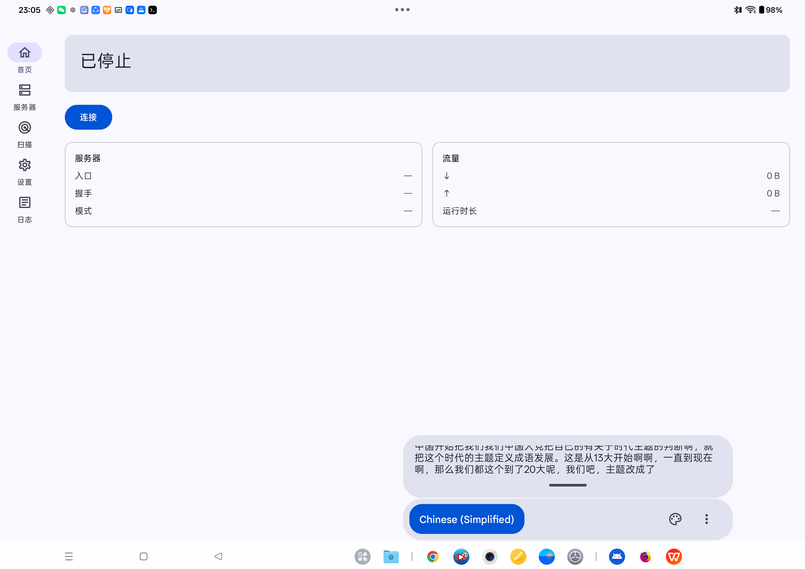

### P5-E2 compact（把窗口压到 438dp）：底部导航 + 单栏

```bash
adb shell wm size 1150x2000   # 438dp @420dpi -> compact
adb shell wm size reset
```

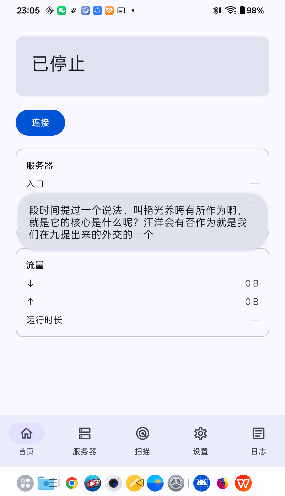

### P5-E3 语言切换

设置 → Language → 简体中文 后 `uiautomator` 读到：

```
首页 | 服务器 | 扫描 | 设置 | 日志 | 已停止 | 连接 | 服务器 | 入口 | — | 握手 | —
```

实现：`AppCompatDelegate.setApplicationLocales`（per-app locale），资源在 `values/` + `values-zh/`。

### P5-E4 日志屏 FLAG_SECURE

进入 Logs 后 `screencap` 的应用区域全黑（只剩状态栏/桌面任务栏等系统窗口），离开即恢复。

### P5-E5 配置导出/导入

`ConfigCodecTest`：往返、篡改拒绝、版本不符拒绝 —— 3/3 通过；导出内容不含 token/password/key。

### P5-E6 连接态（2026-11-20 12:08）

登录后点 Connect，12s 内到 `connected`：

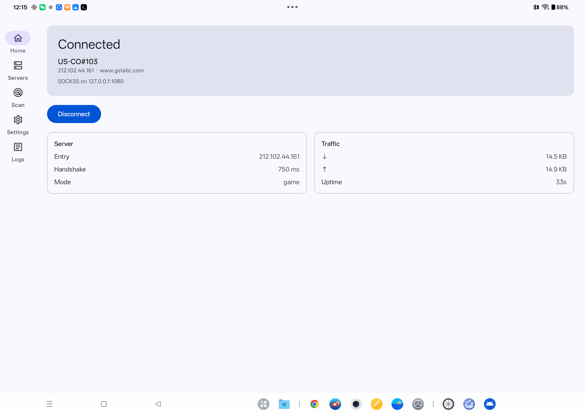

界面读到：`Connected · US-CO#103 · 212.102.44.161 · www.gstatic.com · SOCKS5 on 127.0.0.1:1080`，
握手 **750 ms**、Traffic ↓14.5 KB，Mode game。点 Disconnect 后立即回到 `Stopped`。

### P5-E7 服务器列表（2784 个逻辑服务器）

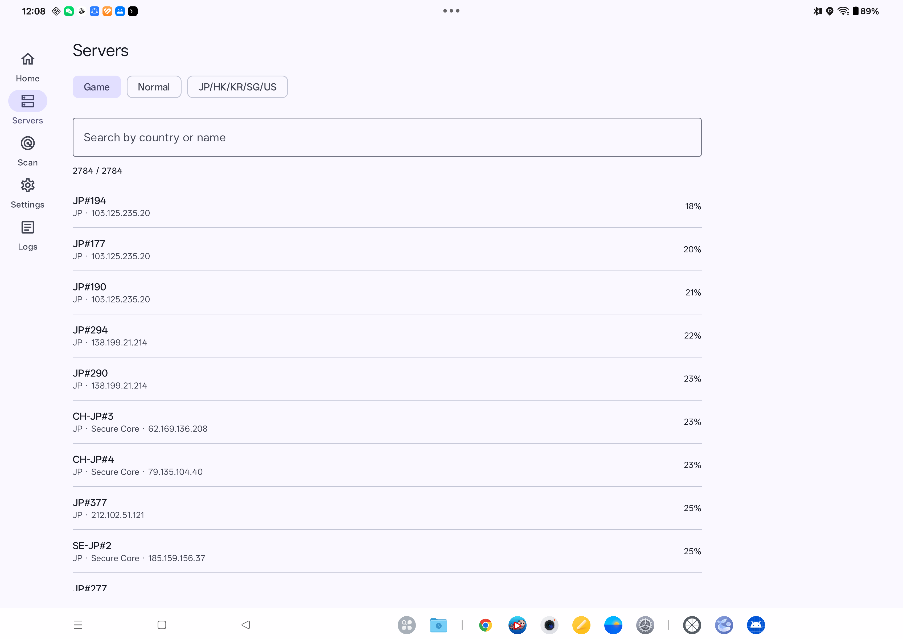

游戏模式下按 JP → HK → KR → SG → US 排序，**不显示 Secure Core**（PROMPT §7），每行给国家、入口 IP、负载。

### P5-E8 扫描（游戏顺序）

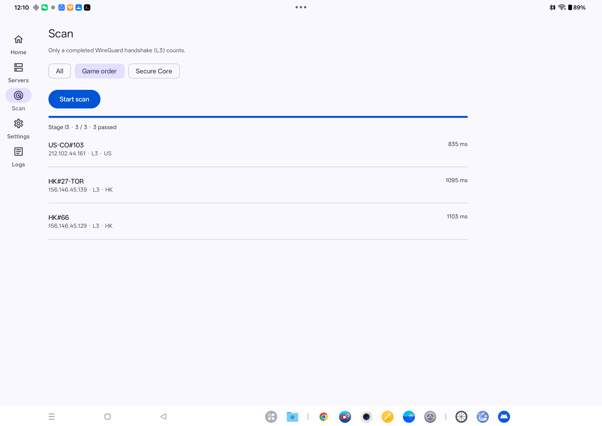

`Stage l3 · 3 / 3 · 3 passed`：US-CO#103（835 ms）、HK#27-TOR（1095 ms）、HK#66（1103 ms）。
这次是**缓存命中**（日志里 `scan: 3 L3-verified entries reused from the cache`），
所以 UI 秒回；冷启动的完整 L1→L2→L3 见 P3-E2。

### P5-E9 日志（FLAG_SECURE 生效时仍可读无障碍树）

```
04:14:24.755 core: initialized (dir /data/user/0/io.github.leggerezza.protonnode.debug/files/core)
04:14:24.772 session: loaded for device protonnode-c88460e1 (uid sfg3i4qc…)
04:14:27.431 servers: 2784 logical servers from the API
04:14:29.678 start: mode game, socks 127.0.0.1:1080, mtu 1320, fingerprint chrome
04:14:30.498 scan: 3 L3-verified entries reused from the cache
04:14:30.503 certificate: reusing serial 18670022153 (expires 2026-11-27T04:06:47Z)
04:14:30.503 server 1/3: US-CO#103 (US, Denver) entry 212.102.44.161 load 41% secure-core=false
04:14:30.758 stealth: tcp connected to 212.102.44.161:443
04:14:30.758 stealth: certificate verification is skipped for the Proton entry (rotating cert; PROMPT.md 0.4)
04:14:31.026 stealth: TLS established with 212.102.44.161:443 (sni www.gstatic.com)
04:14:31.878 tunnel up in 750ms (sni www.gstatic.com)
04:14:31.878 SOCKS5 listening on 127.0.0.1:1080 (TCP CONNECT + UDP ASSOCIATE)
```

（`uid sfg3i4qc…` 是脱敏后的；日志面板是 `FLAG_SECURE`，截图为黑 —— 见 P5-E4。）

### P5-E10 导出 / 导入

设置 → Export：提示 `Configuration copied to the clipboard.`；→ Import：对话框
`Importing replaces your preferences. Continue?` → Import → `OK`。
文档结构由 `ConfigCodec` 生成（version + payload + SHA-256），篡改/版本不符会被拒绝（单测覆盖）。

### P5-E11 本轮修掉的三个真 bug

1. **日志永远是空的**：`Init()` 从没创建 ring log（只有 CLI 建过），`RecentLogs()` 直接返回空/抛异常。
   现在 `Init` 里建 500 行 ring log，`RecentLogs` 也做了 nil 保护，并加了回归测试 `TestRecentLogsAfterInit`。
2. **服务器列表一直空**：ViewModel 初始化时加载早于会话恢复，且进页面不重载。现在 `ServersScreen` 进入即 `loadServers()`。
3. **游戏模式仍列出 Secure Core**：违反 PROMPT §7，已过滤。

### P5-E12 登录反馈与会话有效性（2026-11-20，用户反馈后重做）

用户反馈三个问题：① 界面不告诉你本地会话是否还有效；② "Sign in" 不管有没有会话都往 Proton 发请求；
③ 登录成功没有明显反馈，于是反复点，被 Proton 限流（"Too many requests"）。

改法：

| 问题 | 现在的行为 |
|---|---|
| 会话是否有效 | `SessionState()` 增加 `authState`（`unknown`/`valid`/`expired`）、`lastVerifiedAt`、`authError`。App 重启后是 **unknown**（"已登录 · 尚未验证"），API 拒绝后变 **expired**（"会话已过期——请重新登录" + 错误详情），成功后变 **valid**（"上次验证 …"） |
| 重复登录请求 | `decideLogin()` 先看本地：`loggedIn && !expired` → 直接提示"已登录"，**不发送任何请求**；只有过期/无会话才真正调用 Proton |
| 成功/失败反馈 | 按钮在请求中显示"正在登录…"并禁用；成功显示"登录成功：email"；失败显示原因；限流时按钮变"请 N 秒后再试" |
| 被限流 | `LoginGate`：失败后 30s 冷却，Proton 说限流则 120s，连续失败指数退避（上限 10 分钟），成功清零 |

新增测试：

- `LoginGateTest`（6 项）：冷却、限流时长、退避上限、成功后清零、限流文案识别；
- `LoginDecisionTest`（4 项）：**有效会话绝不发请求**、unknown 视为已登录、expired 允许重新登录、冷却/忙碌/空字段拦截；
- `SessionInfoTest`（4 项）：valid/expired/unknown/garbage 的解析与 `isUsable` 判定；
- Go `TestAuthVerdictIsReportedInSessionState` / `TestIsAuthError`：401 与 2001 都判为 auth 失败，state 里可见。

运行时（2026-11-20 12:45，解锁后）：

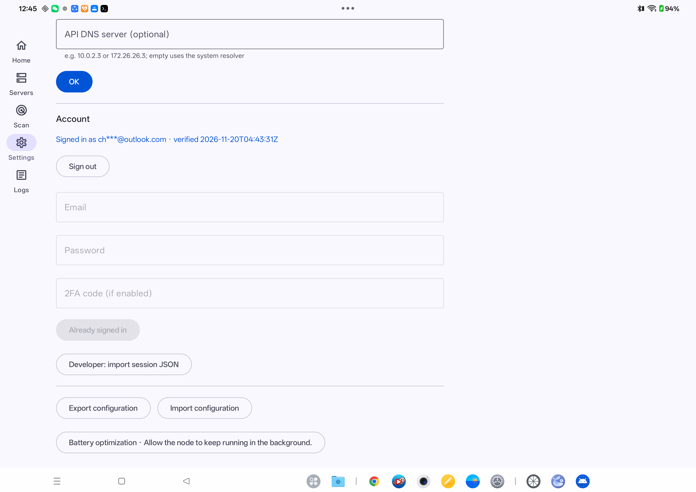

- 状态行：`Signed in as ch***@outlook.com · verified 2026-11-20 12:47`（valid 时是主色）；
- 邮箱/密码/2FA 输入框在已登录时**禁用**，按钮显示 **"Already signed in" 且不可点** —— 不会再发请求；
- 未验证时这里显示 `not verified yet` + 「验证会话」按钮；过期时显示红色「会话已过期」，并在首页也给出提示。

同一轮还加了 **游戏期间锁定服务器** 开关（默认开，PROMPT §7），截图见 `docs/evidence/p5-game-lock.png`；
`buildStartConfig()` 把 `lockServer` 传给 Go 核心，已由 `StartConfigTest` 覆盖（游戏锁定 / 普通不锁 / 可关闭）。

### P5-E13 设备状态

验收结束后：断开连接（节点回到 `Stopped`）、`screen_off_timeout` 还原为 30000 ms、
`stay_on_while_plugged_in` 还原为 15。

## P6 — FlClash 集成与游戏模式（2026-11-20）

### P6 状态：**集成链路打通，8 项验收里能做的都验了；GameNative 相关的留待安装后**

平板：OPD2514，FlClash **dev 0.9.4 (arm64)**，profile 由本应用生成（`FlClashConfig`），
通过 `clash://install-config?url=…` 导入，TUN 模式 + 规则模式。

**关键证据**（FlClash → Requests 实时面板）：

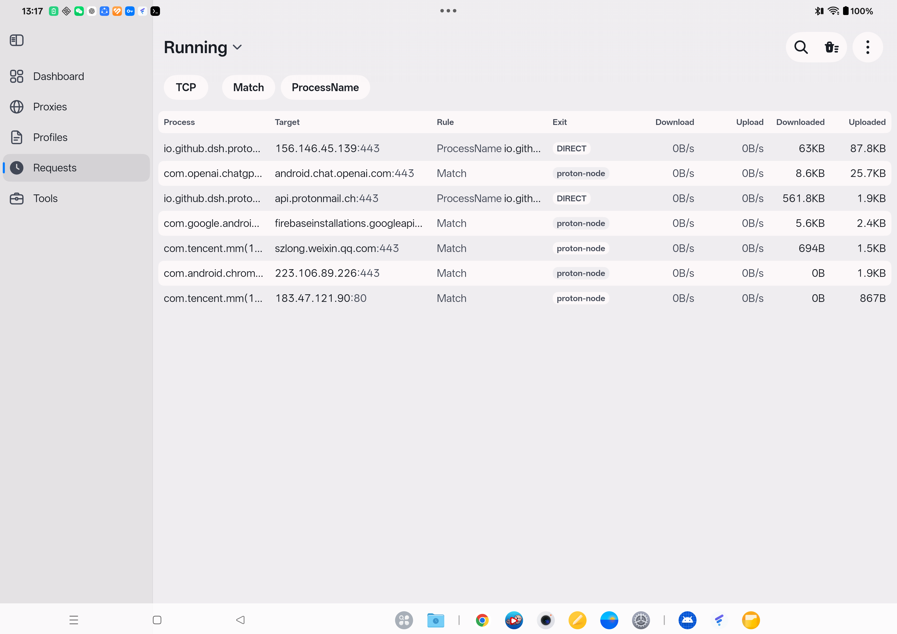

| 进程 | 目标 | 命中的规则 | 出口 |
|---|---|---|---|
| `io.github.leggerezza.protonnode.debug` | 156.146.45.139:443（我们的隧道） | `ProcessName io.github…` | **DIRECT** ✅ |
| `io.github.leggerezza.protonnode.debug` | api.protonmail.ch:443（API） | `ProcessName io.github…` | **DIRECT** ✅ |
| ChatGPT / Google / 微信 / Chrome | 各自目标 | `Match` | `proton-node`（= 我们的 SOCKS5） ✅ |

这张图同时证明了三件事：

1. **防环路生效**：本应用的出站在 FlClash 里被判为 DIRECT，没有回到自己的 SOCKS；
2. **别的应用真的走了我们的节点**：ChatGPT/微信/Chrome 的流量都从 `proton-node` 出去；
3. **TUN 下节点仍能建隧道**：`Connected · HK#27-TOR · 156.146.45.139`，下载 63 KB 已经在跑。

### P6-E1 应用侧状态（TUN 开启时）

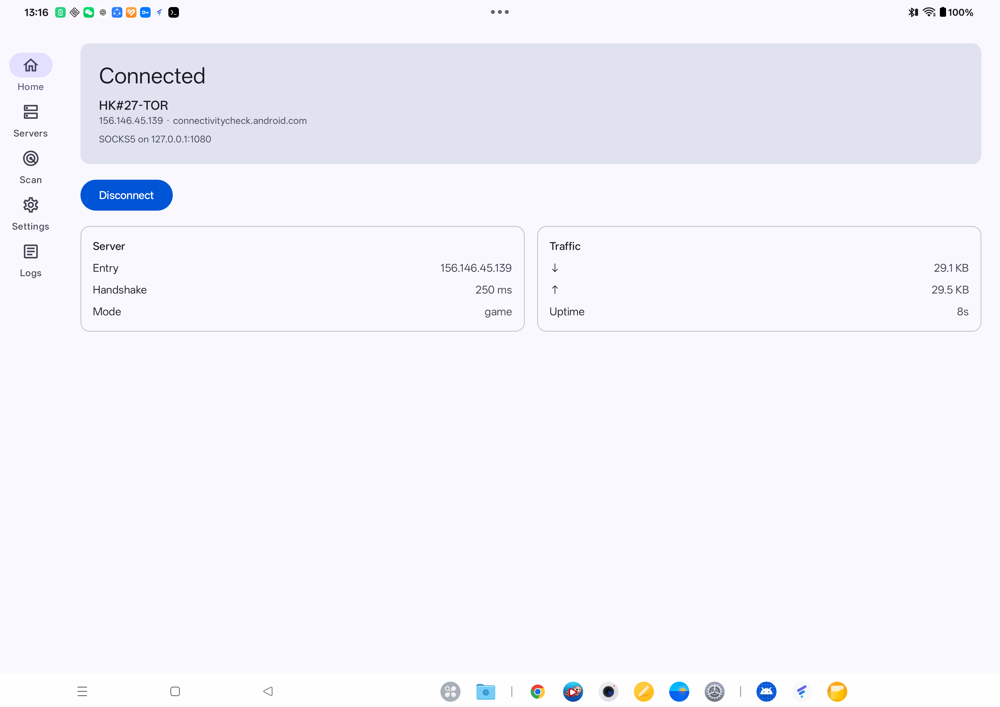

### P6-E5 手动选服务器 / 选国家（2026-11-20）

之前只有自动选服（L3 扫描），用户没法自己指定。现在：

- **Servers 页**：顶部显示 `Selection: Auto / JP#377 / JP`，有 `Auto` 清空按钮；
- 点某一行 → 固定那台服务器（行高亮 + ✓）；点国家 chip（US/JP/HK/SG/KR/DE/NL/GB）→ 固定国家；
- 选择写进 `Prefs`，并作为 `startConfig` 的 `server`/`country` 传给 Go 核心；
- **固定服务器时跳过 L3 缓存**（用户点的是这台，不能被缓存里的别的服务器顶掉）；
- **固定服务器 L3 失败不再回退 L1**：直接报错，避免对着一个 TLS 都不通的入口无限重试。

实测：

```
Selection: US-CO#103 → Connect → Connected · US-CO#103 · 212.102.44.161   ✅
Selection: JP#173   → Connect → Reconnecting…
Last error: pinned server "JP#173" did not pass L3 verification:
            scan: no entry completed a WireGuard handshake        ✅（明确报错，不空转）
```

### P6-E6 新版配置在平板上生效（2026-11-20 15:05）

在 FlClash 里对 profile 点 **Update**（规则数 7 → **48**）并重启 VPN 后：

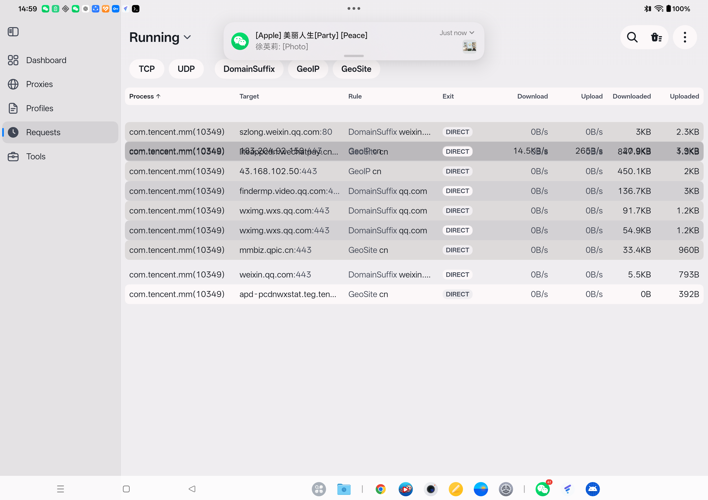

| 进程 | 目标 | 命中规则 | 出口 |
|---|---|---|---|
| com.tencent.mm | szlong.weixin.qq.com:80 | DomainSuffix weixin… | **DIRECT** |
| com.tencent.mm | weixin.qq.com:443 | DomainSuffix weixin… | **DIRECT** |
| com.tencent.mm | wximg.wxs.qq.com:443 | DomainSuffix qq.com | **DIRECT** |
| com.tencent.mm | mmbiz.qpic.cn:443 | **GeoSite cn** | **DIRECT** |
| com.tencent.mm | 43.168.102.50:443 | **GeoIP cn** | **DIRECT** |
| io.github.leggerezza.protonnode.debug | api.protonmail.ch:443 | ProcessName io.github… | **DIRECT** |

微信不再被绕到 Proton 出口；`GEOSITE,cn` 在 FlClash 里能正常加载（48 条规则没报解析错误），
`GEOIP,CN,no-resolve` 也按预期只处理字面 IP。

### P6-E7 已知问题：FlClash TUN 开启时，节点的数据面不可用（待修）

现象：

- TUN 开（`tun0` up）+ 节点 Connect → 握手成功（`tunnel up in 251ms`）、SOCKS 监听正常，
  但 mihomo 转发进来的连接全部 `socks5: CONNECT failed (rep 0x4)`；
- 关掉 FlClash VPN、同一节点 Connect → 立刻 `Connected · JP#294`，一切正常。

排除法说明**节点本身没问题**，问题出在「我们的 TLS/TCP 隧道再被 mihomo 的 TUN 承载」这条路上。
首要嫌疑是 MTU：我们隧道的 MTU 是 1320，而 profile 里 mihomo 的 TUN 是 1280 —— 小包（TLS 握手）
过得去，大包被丢/分片，表现正是「握手成功、数据 dial 失败」。

已做的调整：模板的 `tun.mtu` 改成 **9000**（mihomo 常用默认），待下一轮验证；
若不解决，下一步对比「节点 MTU 降到 1200」与「TUN MTU 9000」两组，并抓 logcat / mihomo 日志定位。

### P6-E7 复测：TUN 下节点恢复工作（2026-11-20 15:21）

把 FlClash 的 profile 重新 Update + 用它的 `com.follow.clash.action.START/STOP` 快捷动作重启后，
节点在 TUN 下 **Connected · JP#373**，并且真实应用流量走通了：

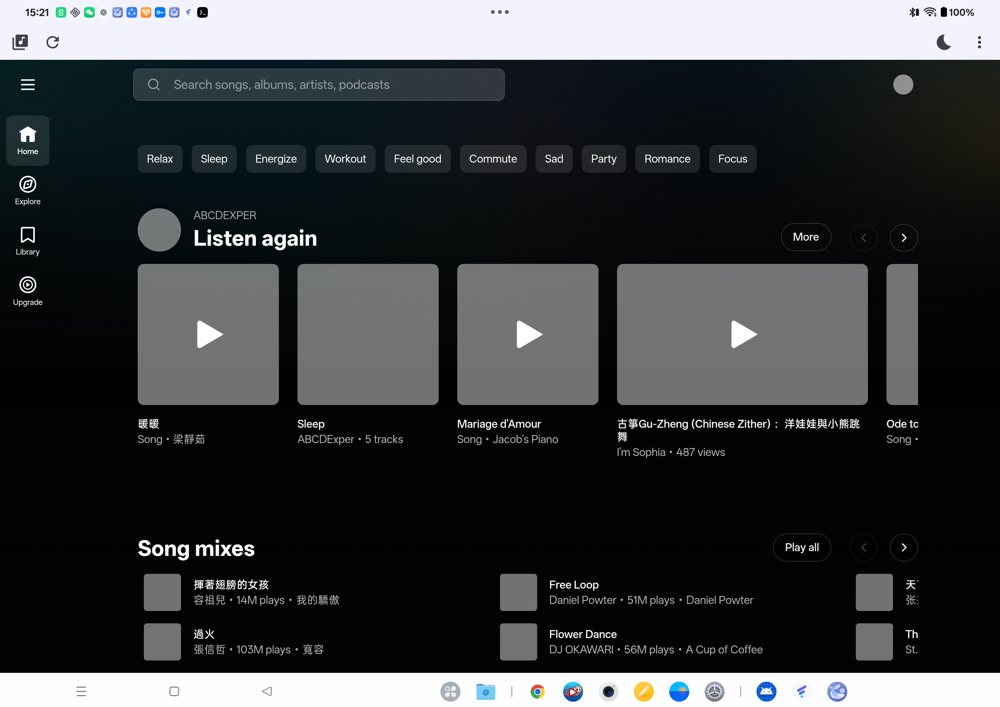

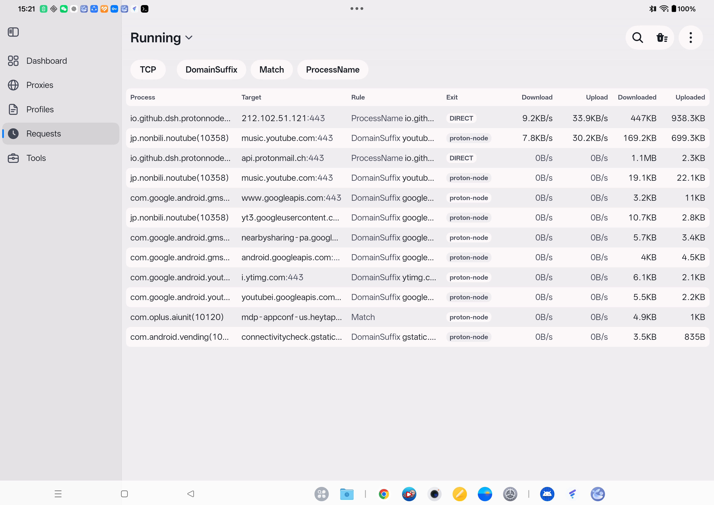

| 进程 | 目标 | 出口 | 流量 |
|---|---|---|---|
| jp.nonbili.noutube | music.youtube.com:443 | **proton-node** | ↓169 KB / ↑699 KB |
| com.google.android.gms | www.googleapis.com:443 | **proton-node** | ↓3.2 KB |
| com.android.vending | connectivitycheck.gstatic.com | **proton-node** | ↓3.5 KB |
| io.github.leggerezza.protonnode.debug | 212.102.51.121:443（隧道本体） | **DIRECT** | ↓447 KB / ↑938 KB |
| io.github.leggerezza.protonnode.debug | api.protonmail.ch:443 | **DIRECT** | ↓1.1 MB |

NouTube 首页已经能加载出歌单/歌曲（文字）；缩略图很慢（当时面板只有 7.8 KB/s），属于吞吐问题，
不是「连不上」。之前 Gemini/NouTube 打不开，对应的是 `rep 0x4` 那段（当时的服务器出口不可用），
换到 JP#373 后恢复正常。

结论修正：**MTU 不是唯一原因**——同样 TUN MTU 9000，换一台出口正常的服务器就通了；之前
连续 `rep 0x4` 更像「那个出口坏了 + 我们对着它死循环」。因此：

- TUN MTU 保持 9000（当前可用）；
- 自动选服在 L3/探活失败时应尽快换服（已实现）；固定服务器时明确报错（已实现）；
- 吞吐偏低（~10 KB/s）列入 P7 调优：对比 MTU 1200/1400/9000、`tcp-concurrent`、以及入口 RTT。

复测（15:22）：NouTube 点歌后 **正常播放**（暖暖 · 梁静茹，0:02/4:04，封面/歌单都加载出来），
FlClash 面板显示：

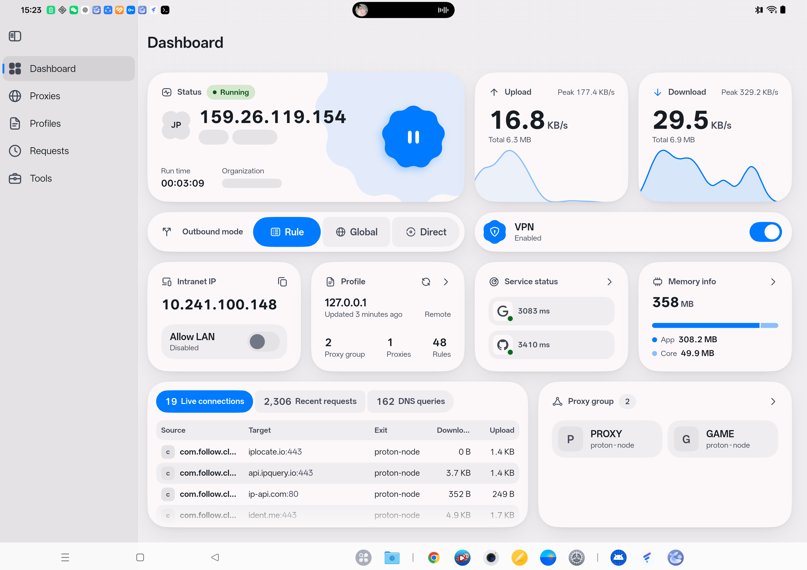

- 出口 IP **159.26.119.154**（Proton），VPN 已连、Rule 模式、48 条规则、2 个组（PROXY/GAME 都指向 proton-node）；
- 实时速率 Down **29.5 KB/s**（峰值 329 KB/s）/ Up 16.8 KB/s，累计 ↓6.9 MB ↑6.3 MB；
- FlClash 自己的连通性检查（iplocate.io / api.ipquery.io / ip-api.com / ident.me）也走 proton-node。

结论：**P6 的集成链路在真机上闭环了** —— TUN 捕获 → mihomo 规则 → proton-node（我们的 SOCKS）→ Proton 出口 → 应用。
音频播放没问题；视频/大图会因为吞吐（~30 KB/s 均速）偏慢，列入 P7 调优（MTU 1200/1500/9000 对比、`tcp-concurrent`、入口 RTT 择优选服）。
### P6-E8 默认国家：用户自己输入两位代码（2026-11-20 16:0x）

设置 → Behavior → **Default country**：

- 输入任意两位字母（大小写都行，自动转大写），如 `jp` → `JP`；留空 = 自动；
- 校验：必须是两位字母，否则字段标红并提示「请输入两位字母的国家代码，例如 JP、US、DE」；
- 保存后写入 Prefs，并清掉单台服务器固定（两者互斥）；
- Servers 页顶部会显示 `Selection: JP`，Auto 可一键清空。

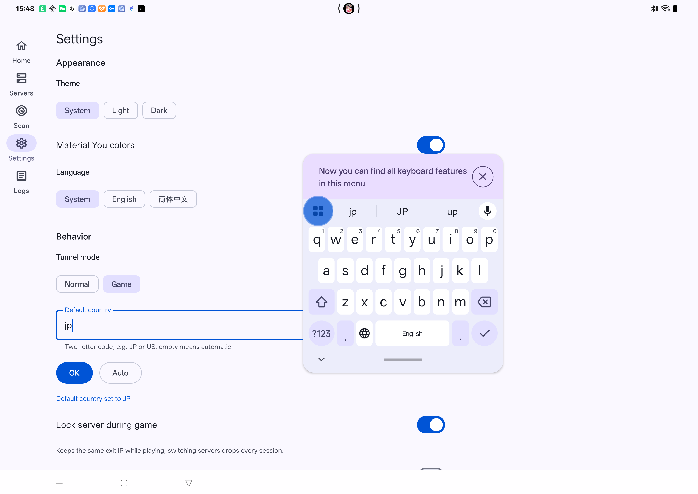

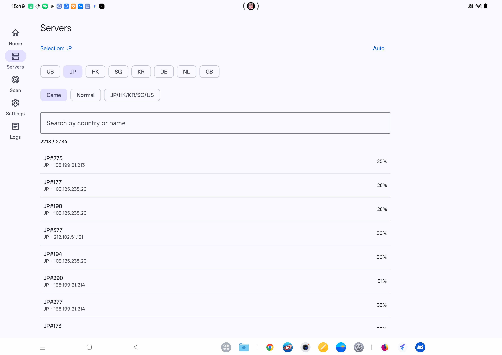

验证：输入 `JPjp`（4 个字符）→ 报错；清空后输入 `jp` → 「Default country set to JP」，
Servers 显示 `Selection: JP`。单测 `CountryCodeTest`（4 项）覆盖空值/大小写/非法/未知代码。
### P6-E9 服务器特性标注（Secure Core / P2P / Tor / Streaming）（2026-11-20 16:4x）

Go 侧 `serverRow` 现在把 Proton 的特性位（`FeatureSecureCore/Tor/P2P/Streaming`）
透出成 `secureCore/p2p/tor/streaming` 四个布尔字段；Servers 页：

- 每行后面显示徽标，例如 `CH · Tor`、`AD · P2P · Streaming · 135.136.16.2`；
- 新增一排可横滑的过滤 chip：**P2P / Tor / Secure Core / Streaming**；
- 游戏模式下**自动排除 Secure Core 和 Tor**（PROMPT §7：Tor 多两跳，延迟不可接受）。

实测（2784 台逻辑服务器）：

| 过滤 | 数量 | 样例 |
|---|---|---|
| P2P | **1971 / 2784** | AD · P2P · Streaming · 135.136.16.2 |
| Tor | **7 / 2784** | CH · Tor、DE · Tor、FR · Tor、HK · Tor |
| 游戏模式 + Tor | 0（被排除） | 空态提示 |

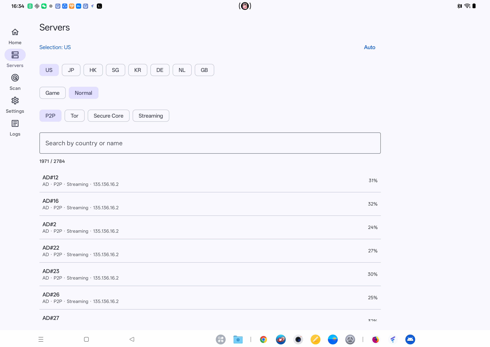

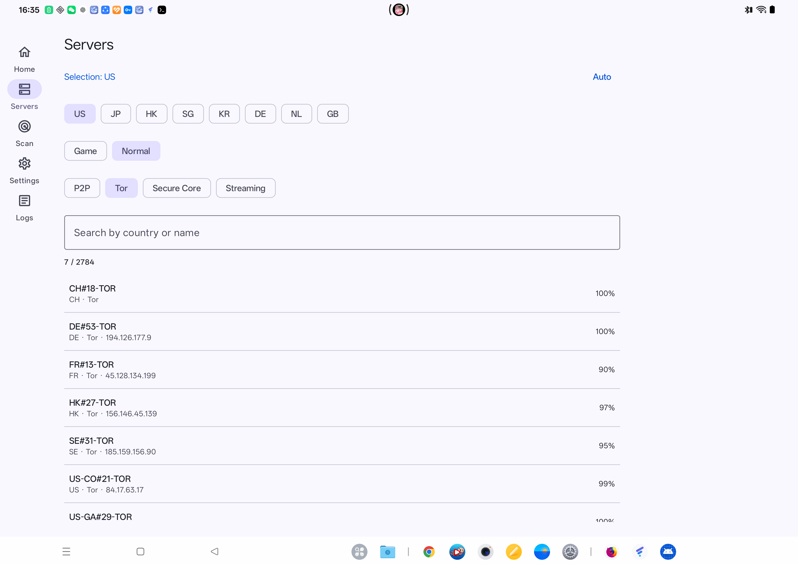
### P7-E1 0.1.3 新增功能实测（2026-11-22 22:2x，平板 OPD2514）

安装 `0.1.3`（versionCode 4）后逐项验证：

**1. 首次启动声明**——只出现一次，Continue 倒计时 3 秒后可点：

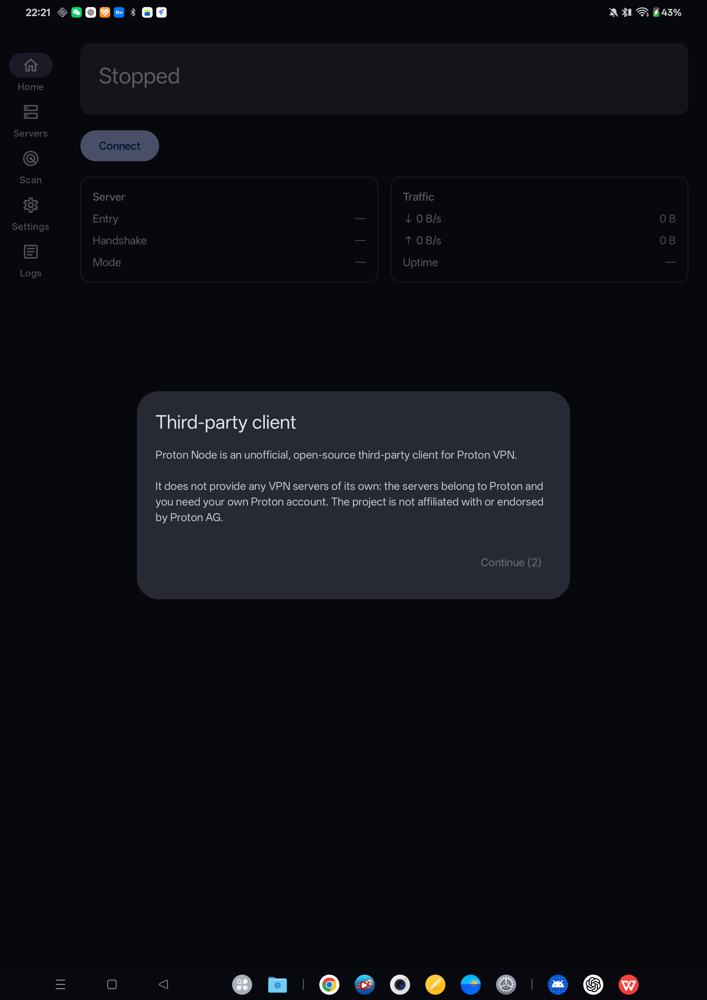

点 Continue 后再冷启动，弹窗不再出现（同一次会话的两张截图一致，prefs 里 `disclaimerAccepted=true`）：

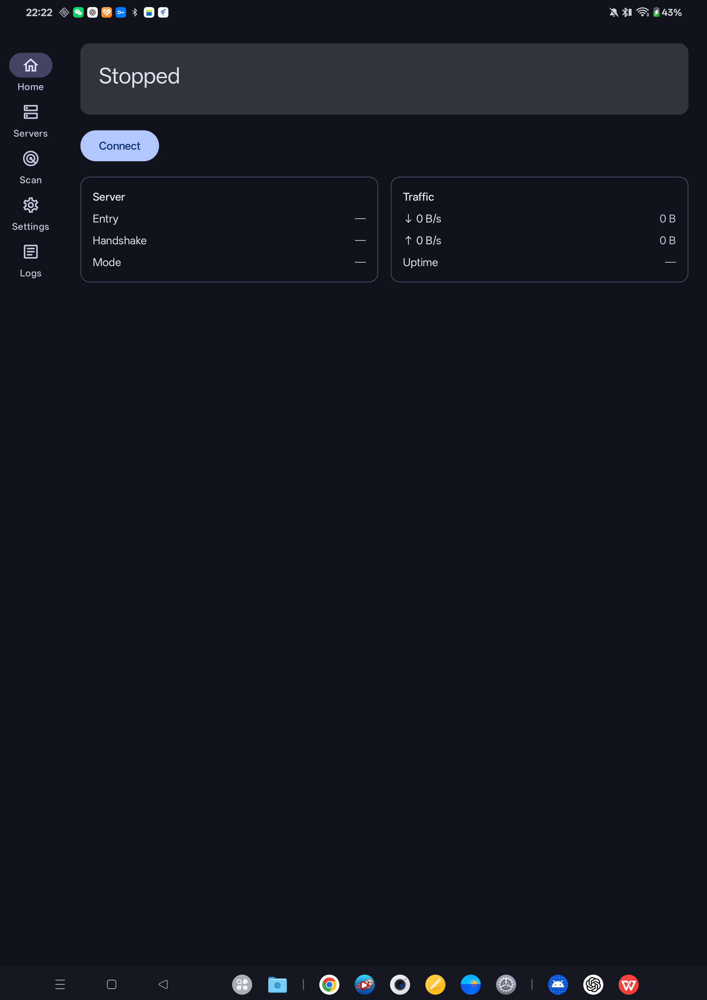

**2. 设置新增项**——传输方式（Stealth / WireGuard UDP）、Enable IPv6、排除国家/地区：


**3. 排除国家/地区**——列表来自服务器清单，显示本地化国名 + 代码 + 数量，可搜索、可勾选：

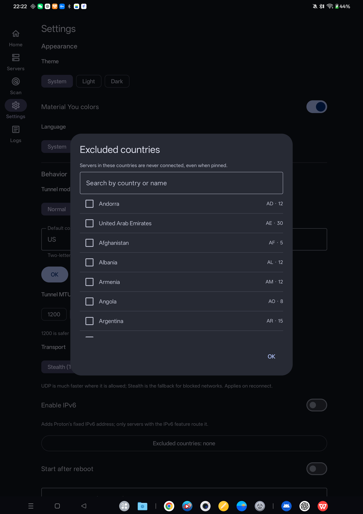

勾选 Andorra 后按钮变为 “Excluded countries: 1 selected”，prefs 写入 `excludedCountries=AD`：

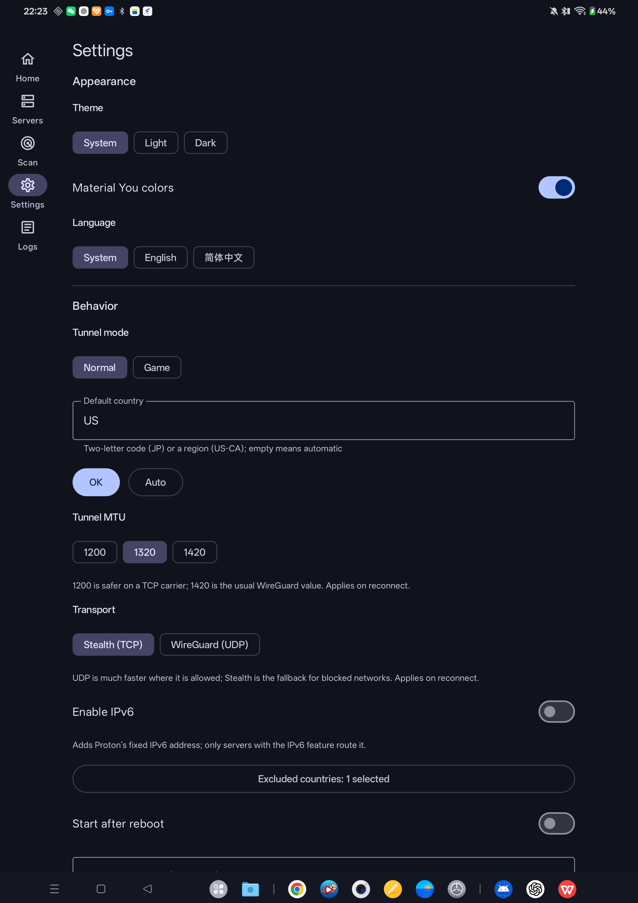

（验证后已取消勾选，恢复为空，避免影响后续测试。）

**未在本轮验证**（需要网络实测）：UDP 传输的实际吞吐、IPv6 站点访问。
### P7-E2 一次真实“网络干扰”日志的分析（2026-11-25）

用户提供的 300 行节点日志（校园网环境）分成两段，正好是“被干扰”与“恢复”的对照：

| 时间 | 现象 | 判读 |
|---|---|---|
| 00:22–00:25 | API 全部 `EOF`；`l1 200/200 reachable` 但 `l2 0/24 tls ok` | TCP 可达、**TLS 被中断**，不是选服或隧道逻辑问题 |
| 00:24 / 00:25 | `connect failed: no entry passed L3 verification`，60s 后重试 | 没有一台完成 TLS，自然没有 L3 |
| 00:36 | `stealth: TLS established ... (sni www.pool.ntp.org)`、`tunnel up in 251ms` | 网络恢复后**一次握手成功** |
| 00:47 | `servers: 2784 logical servers from the API` | API 也恢复 |

结论：失败源于网络对 TLS 的干扰（门户未认证 / 校园防火墙），App 侧的重试与缓存降级行为正确。

据此新增的诊断能力（0.1.4）：

- 扫描汇总带上失败分类：`l2 0/24 tls ok (eof 24, timeout 3)`；
- API 传输层失败时回退一次 `vpn-api.proton.me`；
- 状态行恢复显示实际使用的 SNI（UDP 传输下显示 `udp`）。

界面小改（0.1.4）：服务器行新增 **IPv6** 徽标；首页 Details 卡片新增 **Transport** 与 **IPv6** 两行。
### P6-E2 与 PROMPT §7.1 的 8 条对照

| # | 验收项 | 状态 |
|---|---|---|
| 1 | GameNative 的 TCP/UDP/DNS 被 FlClash 捕获 | ⏳ 未装 GameNative |
| 2 | GameNative 可整体指定到 GAME 组 | ✅ 配置里 `PROCESS-NAME,app.gamenative,GAME` 就位（规则数 7），未实跑 |
| 3 | **本应用不被 FlClash 代理** | ✅ 见上图 DIRECT |
| 4 | UDP ASSOCIATE 多目标并发 ≥16 | ✅ 协议级测试（P2，socks5 包 10+ 用例） |
| 5 | UDP 会话稳定映射（120s 空闲才回收） | ✅ 协议级测试 |
| 6 | 游戏中不因普通健康检查失败换服 | ✅ `lockServer` + 3 轮锁服（`StartConfigTest`） |
| 7 | Steam 登录 / 下载 / UDP 联机 | ⏳ 未装 GameNative |
| 8 | P2P/NAT 限制必须明确报告 | ⏳ 未实现（README 已有 Stealth/NAT 限制说明） |

### P6-E3 说明

- 配置由应用「设置 → FlClash / mihomo 配置 → 复制配置」生成，校验函数会检查
  环路规则、`MATCH` 顺序、socks5 端口与 `udp: true`（单测 `FlClashConfigTest` 6 项）。
- 导入走 `clash://install-config?url=…`；二维码/文件选择器这两条路在平板上都不顺手
  （文件选择器会被系统"打开方式"截走），深链接最稳。
- 设备上 FlClash 与节点目前都保持运行；停止方法：FlClash 面板点 Stop，应用点 Disconnect。

## P7 — 发布（16 KB / SHA256 / SBOM）

`NOT RUN`

## P8 — 安全加固

`NOT RUN`
